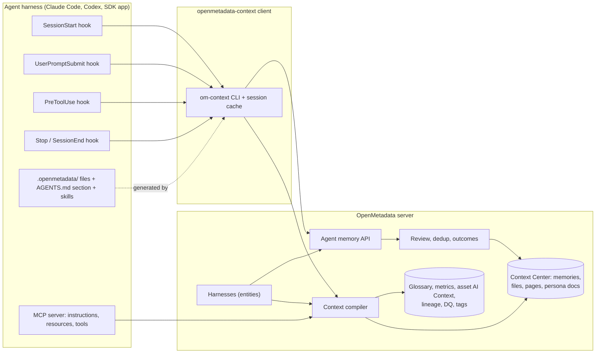

# Context harnesses for every agent surface

- **Status:** Draft for review (no ADR yet; one is written when the design is accepted)
- **Date:** 2026-11-18
- **Scope:** OpenMetadata server, spec, MCP module, UI, and a new client package that installs
  into Claude Code, Codex, and other harnesses

## 1. Problem

OpenMetadata reaches agents through the MCP server (`openmetadata-mcp`). Every piece of context
there is a tool, and the model decides whether to call it. In practice the agent writes SQL against
`raw.orders` without calling `find_context`, never learns that `fct_revenue` is the certified
table, and forgets what it found when the session ends.

Harnesses have channels the model does not choose: instruction files, hooks that run on session
start, prompt submit and tool use, skills, files on disk, MCP server `instructions`, and
admin-managed configuration. A context platform that uses those channels becomes part of every
turn instead of an optional tool.

## 2. Goals and non-goals

Goals:

1. A **default harness** that ships with OpenMetadata and works with no configuration: install one
   package, sign in, and the agent receives governed context on each turn.
2. **Harnesses that admins build**: which knowledge sources are used, on which events, with what
   budget, which instructions and skills, which guardrails, and for which personas, teams, and
   domains. A published harness is what Claude, Codex, and other agents use by default.
3. **Agent memory**: agents store what they learn in Context Center, under the same review,
   visibility, and deduplication rules as memories that people write.
4. One server contract that serves every surface people use (chat apps such as claude.ai, Claude
   Desktop, and ChatGPT; coding harnesses such as Claude Code and Codex; SDK agents), so an
   enterprise governs agent context in one place. Surface-specific code stays in thin adapters.

Non-goals:

- An LLM proxy or gateway. We do not sit between the agent and its model provider.
- Replacing MCP tools. Tools remain for questions the injected context does not answer.
- A new knowledge store. Context Center, the glossary, metrics, and the asset AI Context are the
  stores; this design compiles and distributes them.

## 3. What exists today

| Capability | Where | Reused as |
|---|---|---|
| Context memories: types `Preference`, `UseCase`, `Note`, `Runbook`, `Faq`, `Learning`; scopes `UserGlobal`, `EntityScoped`; visibility `Private` to `Public`; `Draft`/`Approved`/`Archived` lifecycle; supersede and dispute links | `entity/context/contextMemory.json`, `ContextMemoryResource` (`/v1/contextCenter/memories`) | The memory store for agents |
| Machine representation for prompt packing | `contextMemory.machineRepresentation` | Compact text the compiler packs |
| Usage and outcome counters (`appliedCount`, `positiveCount`, `negativeCount`, `correctedCount`) | `PUT /memories/{id}/outcomes`, `MemoryOutcomeWriter` | Ranking signal and the feedback loop |
| Semantic deduplication, reconciliation, conflict review | `SemanticMemoryDuplicateFinder`, `ContextMemoryReconciler`, `context/review/*` | Gate for agent-written memories |
| Review rules: a non-admin's memory starts unapproved and only a review approves it | ADR:2026-10-09-data-consumers-create-context-memories | Agent captures follow the same rule |
| File and page extraction into memories ("knowledge pills") | `FileContextProcessingEngine`, `PageContextProcessingEngine` | Company context source |
| Asset AI Context (identity, knowledge, lineage, type-specific structure, with a context budget) | `type/aiContext.json`, `GetEntityTool` | Asset source |
| Concept routing: question → glossary terms, metrics, articles → candidate assets | `FindContextTool` | Prompt-time retrieval |
| User, persona, and company context | `GetUserContextTool`, `GetPersonaContextTool`, `CompanyContextTool` | Session-start sources |
| Token counting and prompt assembly for chat attachments | `context/entity/TokenCounter`, `ContextEntityPromptService` | Budget enforcement in the compiler |
| T0 user-preference block with `tokenBudget` (500) and `maxItems` | `aiPlatformConfiguration.contextMemoryConfiguration` | Default for the preference section |
| MCP OAuth and SSO consent | ADR:2026-10-19-mcp-oauth-discovery-stays-inside-the-base-path, ADR:2026-10-23-mcp-sso-asks-consent-after-the-idp-round-trip | Sign-in for the client package |
| Credential masking in MCP responses | ADR:2026-10-20-mcp-responses-mask-stored-credentials | Applies to compiled bundles too |

Most of the retrieval exists, but only as tools the model may call, or inside the Collate chat
path. The gaps are: a deterministic compile endpoint, admin-built harnesses, an agent-facing write path
with agent provenance, the client package, and the admin UI.

## 4. Architecture



Five parts:

1. **Harnesses** (§5): entities that admins build and assign, which decide what the compiler
   includes, which instructions and skills agents get, and what agents may write.
2. **Context compiler** (§6): `POST /v1/context/compile`, which returns a ranked bundle within a
   token budget for one event.
3. **Agent memory API** (§7): capture, feedback, and a file-style interface for SDK agents.
4. **Distribution** (§8): the `openmetadata-context` client package (one Agent Plugin for Claude
   Code and Codex, plus a CLI), harness-driven MCP `instructions` and resources, and managed-config
   snippets for admins.
5. **Admin and Context Center UI** (§9): harness builder with a live preview, plus agent captures
   and outcomes in Context Center.

## 5. Harnesses: what to inject, when, and for whom

### 5.1 Which sources to use: glossary, metrics, or assets?

All of them, but **each at the event where it is cheap and precise**. The deciding facts:

- **Glossary terms and metrics** are small, certified, and resolve the vocabulary of a request
  ("ARR", "active customer"). They are the best signal per token, and they lead to assets: a term
  links to the tables that carry it, and a metric to its expression and source. **Default: on, at
  prompt time.**
- **Assets** are many and large. Injecting assets without a concrete target wastes the budget.
  Inject an asset's AI Context only when (a) the request routes to it through a term or metric,
  (b) the prompt or an open file names it, or (c) the repository is bound to it (§8.3). **Default:
  on, routed and bounded (top 3, summary projection).**
- **Lineage, data quality, and tags** matter when the agent is about to read or change a specific
  table. **Default: at PreToolUse on SQL and dbt commands, for the tables touched.**
- **Context Center memories** carry what the catalog does not: preferences, runbooks, learned
  fixes. **Default: preferences at session start, entity-scoped memories with the asset or term
  they attach to, `Learning`/`Runbook`/`Faq` by semantic match at prompt time.**
- **Persona context and company context** set the frame. **Default: at session start.**

### 5.2 Source × event matrix (the `OpenMetadataDefault` harness)

| Source | SessionStart | UserPromptSubmit | PreToolUse (SQL/dbt) | Budget share |
|---|---|---|---|---|
| User identity, teams, domains (`GetUserContextTool`) | ✓ compact | | | 5% |
| Persona AI context doc (`GetPersonaContextTool`) | ✓ | | | 15% |
| Company context pills (file/page extractions, `Shared`+) | ✓ top-k | ✓ by match | | 10% |
| Memories: `Preference`, `UserGlobal`, owned by the caller (T0) | ✓ | | | 10% |
| Memories: `Learning`, `Runbook`, `Faq`, `UseCase` | | ✓ by match | ✓ for the touched entities | 15% |
| Memories: `EntityScoped` | | with their entity | with their entity | (in the entity share) |
| Glossary terms | | ✓ (`FindContextTool` routing) | | 15% |
| Metrics (with variants and expression) | | ✓ | | 10% |
| Asset AI Context | repo-bound assets, names only | routed or mentioned, top 3 | ✓ full projection | 20% |
| Lineage (1 hop), DQ status, freshness | | | ✓ | (in the asset share) |
| Tag guardrails (PII, deprecated, tier) | | | ✓ warn or deny | n/a |

Default total budgets: SessionStart 2,000 tokens, UserPromptSubmit 1,500, PreToolUse 800. These are
starting points to tune with the evals in §11.

### 5.3 Harnesses are entities that admins build

The policy is not one global setting. It is a **`contextHarness` entity**
(`openmetadata-spec/.../entity/context/contextHarness.json`), so admins can build several, version
them, assign them to the people who use them, and ship changes without reinstalling anything on
developer machines. OpenMetadata seeds one, `OpenMetadataDefault`, with the matrix in §5.2. An
admin may edit it, and can restore it to the shipped version.

A harness has five parts:

1. **Retrieval spec**: events, sources, budgets, and guardrails (the YAML below).
2. **Instructions**: a Markdown template that becomes the MCP server `instructions`, the AGENTS.md
   section, and the frame at the top of each SessionStart bundle. It may reference variables
   (`{{persona.name}}`, `{{user.domains}}`, `{{binding.certifiedTables}}`).
3. **Skills**: Markdown procedures authored in OpenMetadata ("compute ARR", "add a DQ test",
   "promote a dbt model"). They are published as `SKILL.md` files in the plugin, as org skills for
   chat apps, and as Context Center `Runbook` memories, so one text serves every surface.
4. **Memory rules**: what agents may capture, the default visibility, and the review requirement
   (§7).
5. **Assignment**: the personas, teams, and domains it applies to, and a priority. A user's
   **effective harness** is the highest-priority published harness assigned to them, falling back
   to `OpenMetadataDefault`.

Lifecycle: `Draft` → `Published`, with entity versions. Clients run only the published version.
The admin preview (§9) runs a draft against real users and prompts before it is published. Every
compile response records the harness id and version, so a result can be traced to the harness
that produced it.

Retrieval spec (abbreviated):

```yaml
events:
  sessionStart:   { enabled: true, tokenBudget: 2000 }
  promptSubmit:   { enabled: true, tokenBudget: 1500, minScore: 0.55 }
  preToolUse:     { enabled: true, tokenBudget: 800, matchers: [sql, dbt, python-notebook] }
  stop:           { enabled: true }   # memory capture
sources:
  glossary:       { enabled: true, events: [promptSubmit], maxItems: 5, certifiedOnly: false }
  metrics:        { enabled: true, events: [promptSubmit], maxItems: 3, includeVariants: true }
  assets:         { enabled: true, events: [promptSubmit, preToolUse], maxItems: 3,
                    routing: [concept, mention, repoBinding], projection: summary }
  lineage:        { enabled: true, events: [preToolUse], depth: 1 }
  dataQuality:    { enabled: true, events: [preToolUse] }
  memories:
    preferences:  { enabled: true, events: [sessionStart], maxItems: 10 }
    learned:      { enabled: true, events: [promptSubmit, preToolUse], types: [Learning, Runbook, Faq, UseCase],
                    statuses: [Approved], includeOwnDrafts: true }
  companyContext: { enabled: true, events: [sessionStart, promptSubmit], maxItems: 5 }
  personaContext: { enabled: true, events: [sessionStart] }
guardrails:
  - { tag: PII.Sensitive, action: warn }      # warn | deny | none
  - { status: Deprecated, action: warn }
memoryCapture:
  enabled: true
  allowedTypes: [Learning, Preference, Runbook, Faq]
  defaultVisibility: Private
  maxPerSession: 5
  requireReview: true                         # agent captures start unapproved (§7.2)
```

Example: a `FinanceAnalyst` harness assigned to the Finance domain raises the metrics share,
denies `PII.Sensitive` tables, adds an "ARR and NRR definitions" skill, and allows `Faq` captures
shared with the Finance team. Everyone else keeps `OpenMetadataDefault`.

Rules:

- A fresh install works with no admin action: `OpenMetadataDefault` is seeded and assigned to
  everyone.
- Guardrails never widen access. RBAC decides what a caller may see; a harness only narrows it.
- Creating and publishing harnesses is an admin operation by default (new `contextHarness`
  resource in the policy model). Domain owners can be granted it for harnesses assigned to their
  domain.
- A small global setting, `contextHarnessConfiguration`, holds only the kill switch, hard limits
  (maximum budget per event, maximum captures per user per day), and the fallback harness. It is
  stored through the settings-source mechanism in `docs/settings-config-source-design.md`.
- `contextMemoryConfiguration.tokenBudget` and `maxItems` (the T0 block) become the defaults of
  `memories.preferences`, so the Collate chat path and external harnesses share one setting.

### 5.4 How a published harness reaches Claude and Codex without reinstalling

The client never bundles a harness. It fetches the effective one:

- `GET /v1/context/harness/effective` returns the user's harness id, version, instructions, and
  skills, with an ETag. The plugin calls it at SessionStart and caches it on disk. A newly
  published version takes effect at the next session.
- The plugin's hooks are fixed and generic (they call `compile` and `capture`). Everything an admin
  changes lives in the harness, so the plugin is installed once, through managed configuration
  (§8.5), and is never edited per team.
- On chat surfaces, the MCP server builds `instructions` and the `get_context` tool description
  from the effective harness at connection time. Org skills are regenerated when a harness is
  published, and the admin page shows which skills changed and need re-uploading where a vendor has
  no API for it.

## 6. Context compiler

### 6.1 API

`POST /v1/context/compile`

```json
{
  "event": "promptSubmit",
  "session": { "id": "c0ffee…", "harness": "claude-code", "harnessVersion": "2.3.1", "model": "claude-opus-5-5" },
  "workspace": { "repo": "git@github.com:acme/analytics.git", "binding": "acme-analytics", "cwd": "models/finance" },
  "prompt": "add a weekly ARR breakdown by region",
  "toolInput": null,
  "tokenBudget": 1500,
  "format": "markdown"
}
```

Response:

```json
{
  "bundleId": "…",
  "tokens": 1312,
  "harness": { "id": "…", "name": "FinanceAnalyst", "version": 7 },
  "text": "<openmetadata-context>…</openmetadata-context>",
  "sections": [
    { "kind": "metric", "fqn": "finance.arr", "score": 0.91, "tokens": 140, "href": "…" },
    { "kind": "glossaryTerm", "fqn": "Business.ARR", "score": 0.88, "tokens": 90 },
    { "kind": "asset", "fqn": "snowflake.prod.finance.fct_revenue", "score": 0.84, "tokens": 420 },
    { "kind": "memory", "id": "…", "memoryType": "Learning", "status": "Approved", "tokens": 75 }
  ],
  "guardrails": [],
  "omitted": [{ "kind": "asset", "fqn": "…", "reason": "budget" }]
}
```

`text` is ready to inject. `sections` gives provenance so the client can report outcomes per item
(§7.3) and the admin preview can explain the bundle. For `preToolUse`, `guardrails` may contain a
`deny` decision that the hook turns into a block.

### 6.2 Pipeline

1. **Resolve the caller**: user, persona, teams, and domains from the token. Pick the
   effective harness (§5.4).
2. **Collect candidates** per enabled source for the event:
   - concept routing through the `FindContextTool` path (glossary terms, metrics, articles, then
     candidate assets);
   - mentioned FQNs and table names parsed from the prompt or `toolInput` (SQL parsed with the
     ingestion SQL lineage parser's table extraction, run server-side via the existing query
     parsing used for lineage; if unavailable, a name match against the repo binding's assets);
   - memories by semantic match (the same index `SemanticMemoryDuplicateFinder` reads), plus
     entity-scoped memories of every selected entity.
3. **Authorize**: drop anything the caller cannot view, using the same search-visibility rules as
   `ContextMemorySearchVisibility` and the asset search filters. Mask credentials.
4. **Rank**: score = relevance × source weight × certification boost × outcome factor. The outcome
   factor comes from `memoryOutcomes` (positive and corrected raise it, negative lowers it).
5. **Pack**: fill by score within each source's budget share, then spend leftover budget in score
   order. Prefer `machineRepresentation.content` when `Ready`, else the summary projection. Count
   with `TokenCounter`.
6. **Deduplicate across the session**: the server keeps a bounded per-session set of bundle item
   ids already sent (Caffeine, `maximumSize` 10,000 sessions, expire after 12 h idle), and a repeat
   item is sent as a one-line reference instead of its body.
7. **Render** into delimited text. Memory and article bodies are user-written, so they are wrapped
   as quoted data with their source, never as instructions (§10).

### 6.3 Latency and failure

- Target p95 under 300 ms for `promptSubmit` and `preToolUse`; SessionStart may take up to 1.5 s.
- The client times out at the harness's limit (default 800 ms) and **fails open**: the turn proceeds
  without context, and the client logs it. A hook must never block an agent because OpenMetadata is
  slow or down.
- The compile endpoint reads search and the entity cache only; no LLM call is on the request path.
  LLM work (machine representations, extraction) stays asynchronous, as it is today.

## 7. Agent memory: how agents store what they learn

### 7.1 Where agent memories live

Agent memories are ordinary `contextMemory` entities. No new store. Changes to the schema:

- New `sourceType` value `AgentCapture`.
- New optional object `sourceAgent`: `{ harness, harnessVersion, model, sessionId, workspaceBinding }`.
  It records which agent wrote the memory, the way `sourceConversation` records chat provenance.
- New optional `memoryScope` value `Workspace`: a memory that applies to one repository binding
  (for example "this dbt project builds incremental models with `unique_key`"). It is ranked into
  bundles only for that binding.

### 7.2 Write paths

| Path | Who calls it | Behaviour |
|---|---|---|
| `POST /v1/context/memories/capture` | Stop/SessionEnd hook, or an explicit "remember this" | Accepts up to `maxPerSession` candidates `{type, title, question, answer, entities[], scope, evidence}`. Runs deduplication: a near-duplicate of an existing memory becomes a usage hit or a proposed revision on that memory, not a new one. New memories start unapproved under the existing non-admin rule; the owner sees them as private drafts immediately. |
| MCP tool `remember` | The model, mid-session | Same endpoint. Added so harnesses without hooks can still write. |
| `/v1/context/memoryfs/*` | SDK agents that use a file-based memory tool (for example Anthropic's client-side memory tool) | Maps `view`, `create`, `str_replace`, `insert`, `delete`, `rename` on `/memories/<path>` to memories. The path maps to scope and folder: `/memories/me/…` → `UserGlobal`, `/memories/entity/<fqn>/…` → `EntityScoped`, `/memories/workspace/<binding>/…` → `Workspace`. Writes go through the capture rules above. |

Capture itself is in the client: at Stop, the hook sends the turn's tool failures and their fixes,
plus explicit user corrections, to `capture`. The server decides what to keep. That keeps
extraction logic in one place (the existing `ContextMemoryExtractor` and reconciler) instead of in
each client.

Review: captures go to Context Center's existing review flow. An admin can set
`memoryCapture.requireReview: false` for `Private` memories only; anything shared beyond the author
always needs review, matching ADR:2026-10-09-data-consumers-create-context-memories.

### 7.3 Feedback

`POST /v1/context/feedback` with `{bundleId, items: [{id, signal}]}`, where `signal` is `applied`,
`helpful`, `unhelpful`, or `corrected`. The client sends `applied` for each item the agent saw.
Explicit signals come from a user correction or an agent report. The server aggregates events and
writes counters through the existing recount path (`MemoryOutcomeWriter`), which stays admin- and
bot-only. Clients never write counters directly.

### 7.4 Making OpenMetadata the agent's memory on each surface

Agents have their own memory features. The aim is that what an agent learns about data ends up in
OpenMetadata, where it is governed, shared after review, and available to every other surface.

| Surface | Native memory | How writes reach OpenMetadata | How reads come back |
|---|---|---|---|
| Claude Code | Local memory files (CLAUDE.md, auto-memory directory) | Stop hook → `capture` (§7.2). Optionally, a PostToolUse hook on writes to the memory directory mirrors new data-related entries to `capture`. | SessionStart bundle (preferences, workspace memories) |
| Codex | AGENTS.md and its own memory settings | Stop hook → `capture`; `remember` tool | SessionStart bundle; the AGENTS.md section from `om-context sync` |
| claude.ai, Claude Desktop, ChatGPT | The vendor's chat memory, which we cannot redirect | `remember` tool. The harness instructions and org skill tell the model to use `remember` for facts about data, metrics, and definitions. | `get_context` returns preferences and matched memories |
| SDK agents | Whatever the developer wires | `memoryfs` as the backend of a file-style memory tool, or `capture` | `compile`, or `memoryfs` reads |

The vendor's chat memory stays the user's personal memory; OpenMetadata does not try to replace
it. The harness narrows what goes to OpenMetadata to organizational knowledge: corrections to
definitions, query fixes, table conventions, runbooks. That is the knowledge other people's agents
benefit from, and the knowledge that needs review before it is shared.

## 8. Distribution: how harnesses use it

### 8.0 Surfaces: one interface, three kinds of client

Enterprise users reach agents through chat apps (claude.ai, Claude Desktop, ChatGPT), through
coding harnesses (Claude Code, Codex CLI and IDE, Cursor), and through agents built on the SDKs.
Enterprises want one governed interface across all of them. The server contract is the same for
every surface: the harness (§5), the compiler (§6), and the memory API (§7). Only the transport
differs, and each surface gets the most deterministic channel it offers.

| Surface | Channels the host controls | How OpenMetadata reaches it | How memories are written |
|---|---|---|---|
| Chat apps (claude.ai, Claude Desktop, ChatGPT; Codex cloud tasks) | Org-provisioned remote MCP connectors, MCP server `instructions`, MCP resources and prompts, org-provisioned skills, project instructions | The **remote MCP server** that admins enable as an org connector. Its `instructions` and an org skill tell the model to call `get_context` first; `get_context` is the compiler exposed as one tool. Resources (`om://context/session`, `om://entity/<fqn>`) can be attached by the user. | `remember` tool, prompted by the skill and the server instructions |
| Coding harnesses (Claude Code, Codex CLI and IDE, Cursor, Gemini CLI) | Managed settings, hooks, AGENTS.md, skills, files on disk, MCP | The `openmetadata-context` plugin (§8.1): hooks call the compiler on every turn, with no model decision; files and AGENTS.md (§8.2) for harnesses without hooks; the same remote MCP server for drill-down | Stop hook → `capture`, plus `remember` |
| SDK agents (Claude Agent SDK, Messages API, OpenAI Agents SDK, internal agents) | The system prompt and tool loop the developer owns | `POST /v1/context/compile` called by the app before each model call | `capture`, `feedback`, and `memoryfs` as the backend of a file-style memory tool |

Chat apps have no hooks, so delivery there is tool-mediated, and that is the weakest link. Three
measures narrow the gap:

1. **One context entry point.** `get_context(question, entities?)` returns a compiled bundle, so
   the model makes one decision instead of choosing among about 20 tools. The existing tools stay
   for drill-down.
2. **Server `instructions` generated from the effective harness** (§8.4): hosts put them in the system prompt,
   so the first instruction the model sees tells it to call `get_context` on any data question.
3. **An org-provisioned skill** that admins upload once (generated by OpenMetadata, §8.5). It
   carries the persona frame and the "call `get_context` first, `remember` corrections" procedure.
   It loads on matching tasks, independently of tool choice.

The remote MCP server is the transport common to every surface: chat apps, coding harnesses, and
SDK agents all support remote MCP. The plugin and files add determinism where the surface allows it,
and do not replace the MCP server.

### 8.1 The `openmetadata-context` client package

One package, two forms: a small CLI (`om-context`) and an **Agent Plugin** that wires the CLI into
harness hooks. The plugin contains:

- `hooks.json`: SessionStart → `om-context compile --event sessionStart`; UserPromptSubmit →
  `--event promptSubmit`; PreToolUse with matchers for SQL and dbt commands and for the
  OpenMetadata MCP tools → `--event preToolUse`; Stop → `om-context capture`. Hook output uses each
  harness's "additional context" field. A `deny` guardrail returns the harness's block decision with
  the reason.
- **Skills** generated from the catalog: `openmetadata-data-context` (how to use certified metrics
  and when to call the MCP tools) and one skill per domain that has a persona doc or runbooks.
  `om-context sync` refreshes them.
- **MCP server configuration** that points to the server's `/mcp` endpoint, so drill-down tools
  remain available.

Sign-in: `om-context login` uses the MCP OAuth flow that already exists, or a personal access
token. Tokens go in the OS keychain, never in the repo.

Packaging is an open decision (§12): a single static binary (Go) avoids requiring Python or Node in
the developer's environment. The ingestion `metadata` CLI is too heavy to install for this.

### 8.2 Files for harnesses without hooks

`om-context sync` writes:

- `.openmetadata/context/` (gitignored): one Markdown file per repo-bound asset, glossary term, and
  metric, plus `index.md`. Any agent can grep it.
- A delimited section in `AGENTS.md` (between `<!-- openmetadata:begin -->` and
  `<!-- openmetadata:end -->`) with the repo's data domains, certified tables, and a pointer to
  `.openmetadata/context/`. AGENTS.md is read by Codex, Cursor, Copilot, Gemini CLI, and, through a
  `CLAUDE.md` link, Claude Code.

### 8.3 Repository bindings

The compiler needs to know which assets a repository touches. In order of precedence:

1. `.openmetadata/binding.yaml` committed in the repo: `{ binding: acme-analytics, services: [...], domains: [...] }`.
2. Detection: a dbt `manifest.json` maps models to OpenMetadata tables through the existing dbt
   ingestion FQN rules; otherwise SQL files are scanned for table names.
3. A server-side `workspaceBinding` record (admin-managed) that lists repo URLs per binding, so a
   binding works without a committed file.

### 8.4 MCP changes

- Server `instructions` are generated from the effective harness: what OpenMetadata is, the persona frame, and
  when to call which tool. Hosts place them in the system prompt, so harnesses that only install the
  MCP server still get a session-start frame.
- MCP resources: `om://context/session` (the SessionStart bundle) and `om://entity/<fqn>` (an
  asset's AI Context), so a user can @-mention them.
- MCP prompts: `/om-context <question>` returns a compiled bundle on demand.
- The `get_context` tool: the compiler with `event: promptSubmit`, for surfaces without hooks
  (§8.0). Its description says to call it first on any question about data, metrics, or
  definitions.
- The `remember` tool (§7.2).

### 8.5 Making it the default in an organization

The admin UI generates managed configuration that force-installs the plugin and MCP server:

- claude.ai and Claude Desktop (Team/Enterprise): the remote MCP connector URL with OAuth settings,
  and the generated skill to provision for the organization.
- ChatGPT (Business/Enterprise): the connector URL and the same instructions.
- Claude Code: a `managed-settings.json` fragment (plugin, MCP server, hooks).
- Codex: a `requirements.toml` and cloud-config fragment.
- Others: the AGENTS.md section and MCP configuration.

The exact admin controls differ by vendor plan and change often; the generator must be checked
against each vendor's current admin documentation before each release.

Admins deploy these with their MDM or the vendors' admin consoles. This is the step that makes
OpenMetadata the default context source for every developer's agent, rather than an install each
developer chooses.

## 9. Admin and Context Center UI

**Settings → AI → Context harnesses** (new pages, ui-core components, `PageLayout`):

- A list of harnesses with their assignment, published version, and usage (sessions per week).
- A **builder** for one harness, with tabs: Sources (the source × event matrix as toggles with
  budgets, starting from §5.2), Instructions (Markdown template with variables), Skills (Markdown
  editor, one per skill), Guardrails, Memory (capture rules), and Assignment (personas, teams,
  domains, priority). Draft → Publish, with a diff against the published version.
- **Preview**: pick a user and an event, type a prompt (and optional SQL), and see the compiled
  bundle with the score, token count, and the reason for each section and omission. Without a
  preview, admins cannot tune a harness.
- Distribution: download the managed-config fragments (§8.5) and the plugin.

**Context Center** additions:

- An **Agents** tab: connected harnesses (from `sourceAgent` and compile telemetry), captures
  waiting for review, and the most-applied and most-corrected memories.
- The memory list filters by `sourceType = AgentCapture` and by harness, and shows outcome counts on
  each memory.
- Workspace-scoped memories appear under their binding.

How Context Center content is used, end to end:

| Context Center content | Read by the harness | Written by agents |
|---|---|---|
| Preferences (`UserGlobal`, private) | SessionStart, T0 block | Capture when the user states a preference |
| Entity-scoped memories | With their entity at prompt time and PreToolUse | Capture tied to the tables an agent fixed a query against |
| Learnings, runbooks, FAQs | Prompt-time semantic match | Capture of failure → fix sequences |
| Company context (file and page pills) | SessionStart top-k and prompt match | No (people upload files) |
| Persona AI context docs | SessionStart | No (admin-authored) |
| Workspace memories (new) | Only for their repo binding | Capture of repo conventions |

## 10. Security

- **Authentication**: OAuth or PAT per user. A bundle is compiled as the calling user, so it never
  contains anything the user cannot view in the UI.
- **Prompt injection through stored text**: memory bodies, article text, and descriptions are
  written by users and by agents. The compiler wraps them in delimited, quoted blocks with their
  source, and by default injects only `Approved` memories plus the caller's own drafts. A draft
  captured by one user's agent never reaches another user before review.
- **Credential masking**: compile output passes through the same masking as MCP responses.
- **Data minimization**: bundles contain metadata, not table data. Sample data and profiler values
  are excluded unless the harness enables them, and they follow the existing sample-data permission.
- **Audit**: each compile and capture records user, harness id and version, and item ids (not
  prompt text by default; prompt logging is an opt-in with a retention limit).
- **Hook trust**: the plugin runs only `om-context`, signed, which makes HTTPS calls to the
  configured server. It does not read files outside the workspace except its own config.

## 11. Measuring whether it helps

- Telemetry per event: latency, tokens, item counts, fail-open rate.
- Outcome rates per source and memory (§7.3).
- An offline eval set: data tasks (write the ARR query, add a DQ test, fix a broken dbt model) run
  with the harness on and off and with alternative policies, scored on correctness against the
  certified definition. The default budgets in §5.2 change only on eval evidence.

## 12. Open decisions

1. Client language: Go static binary (no runtime required) or a Node package (reuses the TS SDK).
   Recommendation: Go.
2. Whether `Workspace` is a new `memoryScope` value or an `EntityScoped` memory attached to a new
   `workspaceBinding` entity. A new entity costs more, but gives bindings an owner and RBAC.
3. Whether PreToolUse `deny` guardrails ship enabled by default, or as `warn` only until admins
   opt in. Recommendation: `warn` by default.
4. Whether the session dedupe set (§6.2) is per server node, or shared through Redis when it is
   configured.
5. OSS and Collate boundary: the compiler, harnesses, capture, and client in OSS; Collate's chat path
   moves onto the same compiler so the two cannot drift.

## 13. Delivery plan

Each phase ends in a state that can be shipped and tested.

| Phase | Ships | Verified by |
|---|---|---|
| P0 | `contextHarness` entity with the seeded `OpenMetadataDefault`, `GET /v1/context/harness/effective`, and the `contextHarnessConfiguration` setting; `POST /v1/context/compile` for `sessionStart` and `promptSubmit`; the `get_context` MCP tool and policy-generated MCP `instructions` (reaches chat apps first); the `om-context` CLI and plugin with those two hooks | Compile ITs per source and RBAC case; a connector test from claude.ai and Claude Desktop; a hook test in Claude Code and Codex against a local server |
| P1 | `AgentCapture` source type and `sourceAgent`; `capture`, `feedback`, and the `remember` tool; Stop hook; Context Center Agents tab | Capture ITs (dedup, review start state, visibility); outcome recount IT |
| P2 | `preToolUse` with SQL table extraction, lineage, DQ, and guardrails; repo bindings and `om-context sync` files and AGENTS.md section | Guardrail ITs (warn, deny, RBAC); binding detection tests on a dbt fixture |
| P3 | Harness builder page (sources, instructions, skills, assignment, draft → publish) with preview; managed-config generator; `memoryfs`; `Workspace` scope | Playwright for the harness builder and preview; memoryfs contract tests |
| P4 | Eval harness and default-budget tuning; Collate chat on the compiler | Eval report comparing policies |
