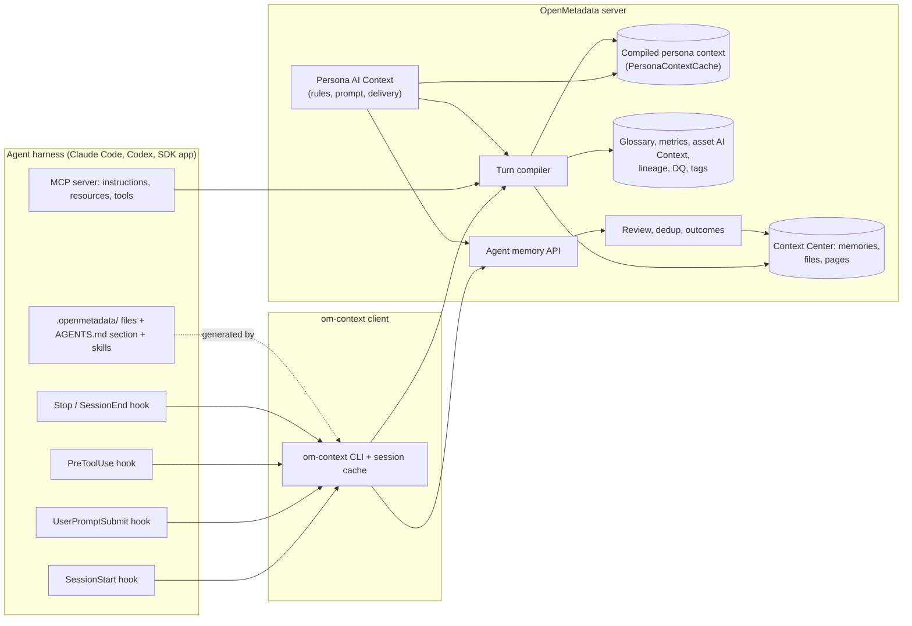
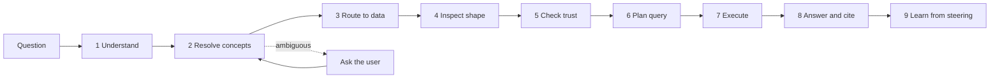

# Persona context harness for every agent surface

- **Status:** Draft for review (no ADR yet; one is written when the design is accepted)
- **Date:** 2026-11-18
- **Scope:** OpenMetadata server, spec, MCP module, UI, and a new client package that installs
  into Claude Code, Codex, and other harnesses
- **Superseded in part by:** `docs/plans/2026-11-18-agent-harness-implementation-plan.md` §1. The
  Agent Harness UI specification makes the harness its own entity, makes persona harnesses extend
  the company default, adds a PostToolUse event, and changes the default budgets and memory
  settings. Where the two documents differ, the implementation plan wins until this document is
  amended

## 1. Problem

OpenMetadata reaches agents through the MCP server (`openmetadata-mcp`). Every piece of context
there is a tool, and the model decides whether to call it. In practice the agent writes SQL against
`raw.orders` without calling `find_context`, never learns that `fct_revenue` is the certified
table, and forgets what it found when the session ends.

Harnesses have channels the model does not choose: instruction files, hooks that run on session
start, prompt submit and tool use, skills, files on disk, MCP server `instructions`, and
admin-managed configuration. A context platform that uses those channels becomes part of every
turn instead of an optional tool.

## 2. Goals and non-goals

Goals:

1. A **default harness** that ships with OpenMetadata and works with no configuration: install one
   package, sign in, and the agent receives governed context on each turn.
2. **Harnesses that admins build per persona**, on top of the existing Persona AI Context: which
   glossary terms, metrics, assets, and articles are used, delivered at which event, with what
   budget, instructions, skills, guardrails, and memory rules. The persona's context is what
   Claude, Codex, and other agents use by default for its members.
3. **Agent memory**: agents store what they learn in Context Center, under the same review,
   visibility, and deduplication rules as memories that people write.
4. One server contract that serves every surface people use (chat apps such as claude.ai, Claude
   Desktop, and ChatGPT; coding harnesses such as Claude Code and Codex; SDK agents), so an
   enterprise governs agent context in one place. Surface-specific code stays in thin adapters.
5. **Zero setup for users**: admins ship one generated plugin and connector through the Claude and
   ChatGPT admin consoles, so every employee has OpenMetadata in claude.ai, Claude Desktop,
   ChatGPT, Codex, and Claude Code with one Connect click (§9.9). An optional binary adds
   per-turn injection on developer machines.
6. An **answer harness** for business questions: approved concepts → data → profile → trust →
   query run as the user → an answer with citations, DQ issues, and open incidents, with the user's
   corrections saved as memories linked to the assets used (§7).

Non-goals:

- An LLM proxy or gateway. We do not sit between the agent and its model provider.
- Replacing MCP tools. Tools remain for questions the injected context does not answer.
- A new knowledge store. Context Center, the glossary, metrics, and the asset AI Context are the
  stores; this design compiles and distributes them.

## 3. What exists today

| Capability | Where | Reused as |
|---|---|---|
| **Persona AI Context**: per persona, an admin-written `prompt` (instructions, up to 8,000 chars) and up to 25 ordered rules. Each rule selects an `entityType` with an Explore query filter, chooses `sections` (description, schema, joins, glossary terms, metrics, lineage, profile, data quality, …), and sets `maxAssets`, `fullyRendered`, `alwaysInContext`, or `filteredInSearch` (deliver as a search scope instead of preloading). Global `characterBudget` (default 400,000) and `cacheTtlMinutes` | `type/personaContextDefinition.json`; `/v1/personas/{id}/aiContext`, `/aiContext/rules`, `/aiContext/rules/preview`, `/aiContext/status` | **The harness.** §5 builds on it instead of adding a new entity |
| Compiled persona context: per rule the selected entities as full `aiContext` objects, shared knowledge (glossary terms, metrics, articles) rendered once, the search scope from `filteredInSearch` rules, a manifest of compacted or omitted entities, a fingerprint | `type/personaContext.json`; `PersonaContextBuilder`, `PersonaContextCache` (local + Redis, single-flight), `/v1/personas/{id}/context?format=json` | The material the turn compiler selects from |
| Active persona per request; a user's default persona | `ActivePersonaContext`, `persona.default` | The first two steps of context resolution (§5.3) |
| Persona context over MCP, split into line-bounded parts | `GetPersonaContextTool` | Today's delivery, which the model has to page through |
| Context memories: types `Preference`, `UseCase`, `Note`, `Runbook`, `Faq`, `Learning`; scopes `UserGlobal`, `EntityScoped`; visibility `Private` to `Public`; `Draft`/`Approved`/`Archived` lifecycle; supersede and dispute links | `entity/context/contextMemory.json`, `ContextMemoryResource` (`/v1/contextCenter/memories`) | The memory store for agents |
| Machine representation for prompt packing | `contextMemory.machineRepresentation` | Compact text the compiler packs |
| Usage and outcome counters (`appliedCount`, `positiveCount`, `negativeCount`, `correctedCount`) | `PUT /memories/{id}/outcomes`, `MemoryOutcomeWriter` | Ranking signal and the feedback loop |
| Semantic deduplication, reconciliation, conflict review | `SemanticMemoryDuplicateFinder`, `ContextMemoryReconciler`, `context/review/*` | Gate for agent-written memories |
| Review rules: a non-admin's memory starts unapproved and only a review approves it | ADR:2026-10-09-data-consumers-create-context-memories | Agent captures follow the same rule |
| File and page extraction into memories ("knowledge pills") | `FileContextProcessingEngine`, `PageContextProcessingEngine` | Company context source |
| Asset AI Context (identity, knowledge, lineage, type-specific structure, with a context budget) | `type/aiContext.json`, `GetEntityTool` | Asset source |
| Concept routing: question → glossary terms, metrics, articles → candidate assets; bounded concept resolution | `AIContextFinder` (`FindContextTool`), `ConceptContextBuilder` | Prompt-time retrieval |
| User and company context | `GetUserContextTool`, `CompanyContextTool` | Session-start sources |
| Query Runner workflow behind Collate's SQL Studio: runs SQL on a service (Snowflake, Databricks, …) as the user, with transpilation and a guardrail row limit; per-user runner configuration with an admin-chosen `authType`; runs readable only by their requester | `entity/automations/queryRunnerRequest.json`, `response/queryRunnerResponse.json`, ADR:2026-11-13-a-query-runner-workflow-is-read-only-by-its-requester | Stage 7 executor in Collate |
| OpenMetadata generates SQL and never runs it | ADR:2026-10-21-ontology-live-data-execution-is-a-collate-extension | Stage 7 executor in OpenMetadata is the host's connector |
| Table and column profiles, sample data, test cases and results, incidents (`testCaseResolutionStatus`: `New`, `Ack`, `Assigned`, `Resolved`) | `tests/*`, table profile APIs | Stages 4 and 5 |
| Ontology over RDF: concept context, ontology description, SPARQL | `GetConceptContextTool`, `OntologyDescribeTool`, `SparqlQueryTool` | Stage 2 |
| Metric expression → columns | `aicontext/MetricColumnResolver` | Stage 3 |
| Budget tracking, prompt-safe text, token counting | `aicontext/BudgetTracker`, `aicontext/PromptText`, `context/entity/TokenCounter` | Packing in the turn compiler |
| T0 user-preference block with `tokenBudget` (500) and `maxItems` | `aiPlatformConfiguration.contextMemoryConfiguration` | Default for the preference section |
| MCP OAuth and SSO consent | ADR:2026-10-19-mcp-oauth-discovery-stays-inside-the-base-path, ADR:2026-10-23-mcp-sso-asks-consent-after-the-idp-round-trip | Sign-in for the client package |
| Credential masking in MCP responses | ADR:2026-10-20-mcp-responses-mask-stored-credentials | Applies to compiled bundles too |

Most of what a harness needs exists. Persona AI Context already lets an admin decide, per persona,
which glossary terms, metrics, assets, and articles an agent gets, with which sections, and with
what instructions, and it compiles and caches the result. What is missing is **delivery**:

- The compiled document is built for a chat assistant that holds the whole document (up to 400,000
  characters). A hook has a budget of 1,000 to 2,000 tokens per turn. Nothing selects the part of
  the document that matters to one prompt or one SQL statement.
- Outside the Collate chat path, the model receives it only if it calls `get_persona_context` and
  pages through it.
- The persona definition has no notion of events, guardrails, memory capture, or skills.
- There is no agent-facing write path with agent provenance, no client package, and no admin
  preview of what an agent would receive on a turn.

## 4. Architecture



Six parts:

1. **Persona AI Context as the harness** (§5): the existing per-persona rules and prompt, extended
   with delivery settings, guardrails, memory capture rules, and skills.
2. **Turn compiler** (§6): `POST /v1/context/compile`, which selects from the cached compiled
   persona context (plus memories and concept routing) and returns a ranked bundle within a token
   budget for one event. It does not build a second document.
3. **Agent memory API** (§8): capture, feedback, and a file-style interface for SDK agents.
4. **Distribution** (§9): the remote connector, a plugin that OpenMetadata generates per
   organization and admins ship through the Claude and ChatGPT admin consoles (§9.2–§9.4), and an
   optional `om-context` binary for developer machines (§9.5).
5. **Answer harness** (§7): a stateful session (`start_answer`, `validate_query`, `run_query` or `report_result`,
   `finish_answer`) that
   takes a business question through approved concepts, data, profile, trust checks, execution,
   and a cited answer, and turns steering into memories.
6. **Admin and Context Center UI** (§10): the persona context editor extended with delivery,
   guardrails, and memory settings, the organization default context, a turn preview, and agent
   captures and outcomes in Context Center.

## 5. Harnesses: what to inject, when, and for whom

### 5.1 Which sources to use: glossary, metrics, or assets?

All of them, but **each at the event where it is cheap and precise**. The deciding facts:

- **Glossary terms and metrics** are small, certified, and resolve the vocabulary of a request
  ("ARR", "active customer"). They are the best signal per token, and they lead to assets: a term
  links to the tables that carry it, and a metric to its expression and source. **Default: on, at
  prompt time.**
- **Assets** are many and large. Injecting assets without a concrete target wastes the budget.
  Inject an asset's AI Context only when (a) the request routes to it through a term or metric,
  (b) the prompt or an open file names it, or (c) the repository is bound to it (§9.7). **Default:
  on, routed and bounded (top 3, summary projection).**
- **Lineage, data quality, and tags** matter when the agent is about to read or change a specific
  table. **Default: at PreToolUse on SQL and dbt commands, for the tables touched.**
- **Context Center memories** carry what the catalog does not: preferences, runbooks, learned
  fixes. **Default: preferences at session start, entity-scoped memories with the asset or term
  they attach to, `Learning`/`Runbook`/`Faq` by semantic match at prompt time.**
- **The persona prompt and company context** set the frame. **Default: at session start.**

In Persona AI Context terms, glossary terms, metrics, assets, and articles are **rules** an admin
already writes (`entityType` plus a query filter and sections). The question an admin answers per
rule is no longer only "include it or not" but "deliver it when": every session, matched to the
prompt, before a tool runs, or only as a search scope.

### 5.2 Source × event matrix (default delivery)

| Source | SessionStart | UserPromptSubmit | PreToolUse (SQL/dbt) | Budget share |
|---|---|---|---|---|
| User identity, teams, domains (`GetUserContextTool`) | ✓ compact | | | 5% |
| Persona `prompt` and `alwaysInContext` rules | ✓ | | | 15% |
| Persona rules (preloaded), selected by relevance to the prompt | | ✓ | ✓ for the touched entities | (in the source shares below) |
| Persona `filteredInSearch` rules | | as the search scope for routing | as the scope check | n/a |
| Company context pills (file/page extractions, `Shared`+) | ✓ top-k | ✓ by match | | 10% |
| Memories: `Preference`, `UserGlobal`, owned by the caller (T0) | ✓ | | | 10% |
| Memories: `Learning`, `Runbook`, `Faq`, `UseCase` | | ✓ by match | ✓ for the touched entities | 15% |
| Memories: `EntityScoped` | | with their entity | with their entity | (in the entity share) |
| Glossary terms | | ✓ (`FindContextTool` routing) | | 15% |
| Metrics (with variants and expression) | | ✓ | | 10% |
| Asset AI Context | repo-bound assets, names only | routed or mentioned, top 3 | ✓ full projection | 20% |
| Lineage (1 hop), DQ status, freshness | | | ✓ | (in the asset share) |
| Tag guardrails (PII, deprecated, tier) | | | ✓ warn or deny | n/a |

Default total budgets: SessionStart 2,000 tokens, UserPromptSubmit 1,500, PreToolUse 800. These are
starting points to tune with the evals in §12.

### 5.3 Persona AI Context is the harness

There is no new harness entity. A persona's AI context is the harness, and persona membership is
its assignment. When the caller has no persona context, the **organization default context**
applies: a context that admins define once, with the same shape as a persona's context.

Resolution, evaluated per request, first match wins:

```text
if   active persona (ActivePersonaContext) has an enabled context  -> that persona's context
elif user's default persona has an enabled context                 -> that persona's context
elif admin-defined organization default context is enabled         -> organization default
else                                                               -> built-in default (shipped, read-only)
```

"Has an enabled context" means `contextDefinition.enabled` is true and the context has a prompt or
at least one enabled rule. A persona whose context is empty or disabled falls through, so turning a
persona's context off never leaves its members without context.

The organization default is stored in `contextHarnessConfiguration.defaultContext` and uses the same
`personaContextDefinition` schema, so it has one editor, one compiler, and one cache path
(`PersonaContextCache` under a fixed key such as `org-default`). Until an admin edits it, it equals
the built-in default: the §5.2 delivery and a starter rule set (certified glossary terms and metrics
as search scope, Tier 1 tables as search scope, a short prompt that says what OpenMetadata is and
when to call `get_context`). "Restore built-in default" resets it.

Settings that are not about content inherit, so admins set them once:

| Field | When the resolved context is a persona's |
|---|---|
| `prompt`, `rules` | The persona's own. Content is never merged with the default |
| `delivery` | Each budget the persona leaves unset comes from the organization default |
| `guardrails` | Union of the organization default's and the persona's; the stricter action wins per tag or status. A persona cannot weaken an organization guardrail |
| `memoryCapture` | Fields the persona leaves unset come from the organization default; `requireReview` can only be made stricter |

Every bundle names what was resolved (`"context": {"source": "persona" | "orgDefault" | "builtIn",
...}`), so a user or admin can see why an agent received what it did.

| Harness concern | Persona AI Context today | Added by this design |
|---|---|---|
| Instructions | `prompt` | Rendered as MCP `instructions`, the AGENTS.md section, and the head of the SessionStart bundle |
| What to include | Ordered `rules` (`entityType`, `queryFilter`, `sections`, `maxAssets`, `fullyRendered`) | Nothing |
| Always present | `alwaysInContext` | Mapped to SessionStart |
| Search scope instead of preload | `filteredInSearch` → `searchScope` | Applied to concept routing and prompt-time search |
| When to deliver | No | Per rule `deliverAt: [sessionStart, promptSubmit, preToolUse]`. Absent means the defaults: `alwaysInContext` → `sessionStart`; other preloaded rules → `promptSubmit` and `preToolUse` |
| Budgets | `characterBudget` for the whole document | `delivery` object with a token budget per event (§5.2 defaults) |
| Guardrails | No | `guardrails`: tag, tier, or status → `warn` / `deny` / `none` at PreToolUse |
| Memory capture | No | `memoryCapture`: allowed types, default visibility and share target (e.g. the persona's team), review requirement, per-session cap |
| Skills | Articles (`page`) can be selected by a rule | Per rule `exportAsSkill`: matched pages are published as `SKILL.md` files and org skills |
| Default for everyone | No (a persona marked `default` only assigns a persona) | The organization default context and the built-in default (above) |

Additions to `personaContextDefinition.json` (abbreviated):

```yaml
prompt: "You support finance analysts. Revenue questions use the certified ARR metric…"
rules:
  - { name: Finance metrics, entityType: metric, queryFilter: "<domain = Finance>",
      sections: [definition, formulaExpression, unitGrain, owner], deliverAt: [promptSubmit] }
  - { name: Revenue tables, entityType: table, queryFilter: "<tier = Tier1 AND domain = Finance>",
      sections: [description, schema, joins, glossaryTerms], deliverAt: [promptSubmit, preToolUse] }
  - { name: Finance glossary, entityType: glossaryTerm, filteredInSearch: true }
  - { name: Finance runbooks, entityType: page, queryFilter: "<tag = Runbook>",
      alwaysInContext: false, exportAsSkill: true }
delivery:                                   # new
  sessionStart:  { tokenBudget: 2000 }
  promptSubmit:  { tokenBudget: 1500, minScore: 0.55 }
  preToolUse:    { tokenBudget: 800, matchers: [sql, dbt] }
  memories:      { preferences: 10, learned: [Learning, Runbook, Faq, UseCase] }
guardrails:                                 # new
  - { tag: PII.Sensitive, action: deny }
  - { status: Deprecated, action: warn }
memoryCapture:                              # new
  enabled: true
  allowedTypes: [Learning, Preference, Faq]
  defaultVisibility: Shared
  shareWith: { team: Finance, role: Viewer }
  requireReview: true                       # agent captures start unapproved (§8.2)
  maxPerSession: 5
```

Rules:

- A fresh install works with no admin action: everyone resolves to the built-in default until an
  admin defines the organization default or a persona context.
- Guardrails never widen access. RBAC decides what a caller may see; a persona only narrows it.
- Editing a persona's context stays admin-only, as today.
- A global setting, `contextHarnessConfiguration`, holds the kill switch, hard limits (maximum
  token budget per event, maximum captures per user per day), and `defaultContext`. It is stored through the
  settings-source mechanism in `docs/settings-config-source-design.md`.
- `contextMemoryConfiguration.tokenBudget` and `maxItems` (the T0 block) become the defaults of
  `delivery.memories.preferences`, so the Collate chat path and external agents share one setting.

### 5.4 How a persona change reaches Claude and Codex without reinstalling

Neither the plugin nor the binary bundles persona content. It is resolved on the server at run
time:

- Every connector call (`get_context`, `start_answer`) resolves the caller's context through the
  §5.3 chain, and the connector's `instructions` are rendered from it when the host connects. A rule
  or prompt change takes effect on the next call, with nothing to redeploy.
- With `om-context` on the machine, the SessionStart hook also calls `GET /v1/context/session`,
  which returns the resolved persona (id, name, entity version, context `fingerprint`), the rendered
  instructions, and the skill list, with an ETag.
- The plugin's skills, commands, and hooks are generic. Only skills exported from persona rules
  (`exportAsSkill`) live in the plugin, so changing those regenerates the plugin, which reaches
  users through re-sync or marketplace auto-update (§9.3, §9.4).
- On chat surfaces, the MCP server builds `instructions` and the `get_context` tool description
  from the caller's persona at connection time. Org skills are regenerated when an
  `exportAsSkill` rule's matches change, and the admin page shows which skills need re-uploading
  where a vendor has no API for it.

## 6. Context compiler

### 6.1 API

`POST /v1/context/compile`

```json
{
  "event": "promptSubmit",
  "session": { "id": "c0ffee…", "harness": "claude-code", "harnessVersion": "2.3.1", "model": "claude-opus-5-5" },
  "workspace": { "repo": "git@github.com:acme/analytics.git", "binding": "acme-analytics", "cwd": "models/finance" },
  "prompt": "add a weekly ARR breakdown by region",
  "toolInput": null,
  "tokenBudget": 1500,
  "format": "markdown"
}
```

Response:

```json
{
  "bundleId": "…",
  "tokens": 1312,
  "context": { "source": "persona", "persona": "FinanceAnalyst", "version": 7, "fingerprint": "…" },
  "text": "<openmetadata-context>…</openmetadata-context>",
  "sections": [
    { "kind": "metric", "fqn": "finance.arr", "score": 0.91, "tokens": 140, "href": "…" },
    { "kind": "glossaryTerm", "fqn": "Business.ARR", "score": 0.88, "tokens": 90 },
    { "kind": "asset", "fqn": "snowflake.prod.finance.fct_revenue", "score": 0.84, "tokens": 420 },
    { "kind": "memory", "id": "…", "memoryType": "Learning", "status": "Approved", "tokens": 75 }
  ],
  "guardrails": [],
  "omitted": [{ "kind": "asset", "fqn": "…", "reason": "budget" }]
}
```

`text` is ready to inject. `sections` gives provenance so the client can report outcomes per item
(§8.3) and the admin preview can explain the bundle. For `preToolUse`, `guardrails` may contain a
`deny` decision that the hook turns into a block.

### 6.2 Pipeline

1. **Resolve the caller and the context**: user, teams, and domains from the token; then the
   context by the §5.3 chain (active persona, default persona, organization default, built-in).
2. **Load the compiled context** from `PersonaContextCache`. The request path never
   compiles: on a miss or a `STALE` entry it uses the last snapshot (or none) and asks the cache's
   single-flight coordinator to refresh in the background.
3. **Collect candidates** per rule and source for the event:
   - SessionStart: the persona `prompt`, entities of rules delivered at `sessionStart`
     (`alwaysInContext` by default), and a one-line-per-rule manifest of what else is available;
   - promptSubmit and preToolUse: entities from the compiled rules whose `deliverAt` includes the
     event, ranked against the prompt or tool input. They are already rendered as `aiContext`
     objects with the rule's `sections`, so no entity is fetched again;
   - shared knowledge (glossary terms, metrics, articles) referenced by the selected entities, from
     `sharedKnowledge`;
   - concept routing through `AIContextFinder` and `ConceptContextBuilder`, restricted to the
     persona `searchScope` when its `filteredInSearch` rules define one;
   - for entities a request names that the persona did not preload: FQNs and table names parsed from the prompt or `toolInput` (SQL parsed with the
     ingestion SQL lineage parser's table extraction, run server-side via the existing query
     parsing used for lineage; if unavailable, a name match against the repo binding's assets);
   - memories by semantic match (the same index `SemanticMemoryDuplicateFinder` reads), plus
     entity-scoped memories of every selected entity.
4. **Authorize**: drop anything the caller cannot view, using `PersonaContextVisibility`,
   `ContextMemorySearchVisibility`, and the asset search filters. Mask credentials.
5. **Rank**: score = relevance × source weight × certification boost × outcome factor. The outcome
   factor comes from `memoryOutcomes` (positive and corrected raise it, negative lowers it).
6. **Pack**: fill by score within each source's budget share, then spend leftover budget in score
   order with `BudgetTracker`. For memories prefer `machineRepresentation.content` when `Ready`;
   for entities use the rule's rendered sections, compacted when they exceed the share. Count with
   `TokenCounter`.
7. **Deduplicate across the session**: the server keeps a bounded per-session set of bundle item
   ids already sent (Caffeine, `maximumSize` 10,000 sessions, expire after 12 h idle), and a repeat
   item is sent as a one-line reference instead of its body.
8. **Render** into delimited text. The persona `prompt` goes in the instructions part; everything else is reference data. Memory and article bodies are user-written, so they are wrapped
   as quoted data with their source, never as instructions (§11).

### 6.3 Latency and failure

- Target p95 under 300 ms for `promptSubmit` and `preToolUse`; SessionStart may take up to 1.5 s.
- The client times out at a configured limit (default 800 ms) and **fails open**: the turn proceeds
  without context, and the client logs it. A hook must never block an agent because OpenMetadata is
  slow or down.
- The compile endpoint reads search and the entity cache only; no LLM call is on the request path.
  LLM work (machine representations, extraction) stays asynchronous, as it is today.

## 7. Answer harness: from a business question to a cited answer

Injected context helps an agent that writes code. A business user asks a different kind of
question: "what was customer churn rate last quarter?", "how many tickets were closed in Texas in
the last 24 hours?". For these, the harness is not a bundle of text but a **procedure** that the
agent follows, with OpenMetadata deciding what counts as the right definition, the right data, and
a trustworthy result:



### 7.1 The stages

| # | Stage | What happens | OpenMetadata parts used |
|---|---|---|---|
| 1 | **Understand** | Split the question into measures ("churn rate", "tickets closed"), dimensions and filters ("Texas"), time window ("last quarter", "last 24 hours"), and grain. Time phrases resolve through the organization's calendar (fiscal year start, time zone) from the harness configuration | Harness `calendar` |
| 2 | **Resolve concepts** | Bind each phrase to **approved** knowledge: glossary terms (and their synonyms and related terms), ontology relations (term → metric → column), metrics (expression, grain, allowed dimensions), articles and runbooks ("how churn is computed"), and approved memories (earlier corrections). When a phrase binds to more than one concept with similar confidence ("logo churn" or "revenue churn"), ask the user instead of guessing | `AIContextFinder`, `ConceptContextBuilder`, `get_concept_context` and `ontology_describe` (RDF), glossary term status, metrics, Context Center memories |
| 3 | **Route to data** | From the bound concepts to tables and columns: a metric to the columns its expression uses, a term to the columns tagged with it, an ontology relation to the asset it maps to. Prefer certified, higher-tier, and downstream (gold-layer) assets by lineage; keep only assets the user can see and the persona allows. Pick a primary table and the joins its documentation declares | `MetricColumnResolver`, lineage, tiers and certification, persona `searchScope`, table `joins` |
| 4 | **Inspect shape** | Read the profile of the chosen columns: row count, null and distinct ratios, min and max, value distribution (is Texas stored as `TX`, `Texas`, or a region id?), and freshness. Sample values only where the persona allows and the user has the sample-data permission | Table and column profiles, sample data |
| 5 | **Check trust** | Find failing data quality tests on the chosen tables and columns, open incidents (`testCaseResolutionStatus` in `New`, `Ack`, or `Assigned`), freshness against the expected schedule, and deprecated or PII-tagged columns. Per harness configuration, warn, ask, or stop | Test cases and results, incidents, tags, guardrails (§5.3) |
| 6 | **Plan query** | The agent writes the SQL, starting from the metric expression and the profile. The server validates it before execution: only tables from the plan (or a warning), PII columns per guardrail, a time filter where the question has one, the row limit, and dialect transpilation | SQL table extraction (lineage parser), guardrails, Query Runner transpile |
| 7 | **Execute** | Run the validated query where the data lives (Snowflake, Databricks, BigQuery, …) **as the user**, never with a shared admin account. Who executes depends on the deployment (§7.2a): in Collate, SQL Studio; in OpenMetadata, the host agent's own warehouse connector | Collate: SQL Studio (Query Runner workflow, per-user runner configuration). OpenMetadata: none; it returns validated SQL (ADR:2026-10-21-ontology-live-data-execution-is-a-collate-extension) |
| 8 | **Answer and cite** | The agent states the answer. The server returns a citation block it assembles itself, so citations cannot be invented: definitions used (with approval status and version), tables and columns, filters and time window, the SQL, data freshness, DQ issues, open incidents, and a link to the full trace | Answer trace (§7.4) |
| 9 | **Learn from steering** | When the user corrects or steers ("exclude trial accounts", "I mean fiscal quarters", "Texas is `region_code = 'TX'`"), turn it into a memory linked to the assets and concepts in the plan (§7.5) | Context Center memories, review flow |

### 7.2 Who does what: the host model reasons, the server owns the facts

The host model (Claude, GPT, Codex) is the reasoner. OpenMetadata does not run a second LLM on this
path. The server owns every step that has a deterministic answer, so the result does not depend on
the model remembering to call eight tools in order:

| Server (deterministic, governed) | Host model (language and judgement) |
|---|---|
| Concept binding candidates and scores, routing, profile lookup, trust checks | Interpreting the question, choosing between close candidates, asking the user |
| SQL validation against the plan; execution as the user in SQL Studio (Collate) | Writing the SQL; running it through its own warehouse connector when that is the executor |
| Citation block and trace | Writing the answer in prose |
| Turning a detected correction into a memory proposal | Recognizing that the user steered |

This is exposed as a small **stateful answer session** instead of many independent tools:

| MCP tool | Does |
|---|---|
| `start_answer(question, refines?)` | Runs stages 1–5 under the caller's harness and returns a **brief**: the bound concepts with their definitions and approval status, open ambiguities, the chosen table(s) with columns, joins, and profile hints, trust warnings, and an `answerId`. `refines` links a follow-up to the answer it corrects |
| `validate_query(answerId, sql)` | Stage 6. Checks the SQL against the plan and guardrails, transpiles it to the service's dialect, and returns the approved SQL with a `queryToken` (a hash of the approved SQL bound to the answer) and the executor to use |
| `run_query(answerId, queryToken)` | Stage 7 when the executor is SQL Studio. Returns rows, the executed SQL, duration, and annotations (for example "column `state` has 3% nulls, excluded by your filter") |
| `report_result(answerId, queryToken, executedSql, rowCount, summary)` | Stage 7 when the host's connector executed. Records what ran so the trace and citations stay complete |
| `finish_answer(answerId, answer)` | Stage 8. Returns the citation block and the trace link, rendered as an MCP Apps view where the host supports it |
| `remember` | Stage 9, explicit form (§8.2) |

### 7.2a Who executes the query

| Deployment | Default executor | Why |
|---|---|---|
| **Collate** | **SQL Studio**, always, unless the admin allows otherwise | The customer controls execution in one place: per-user warehouse credentials and auth types set by admins, runs readable only by their requester (ADR:2026-11-13-a-query-runner-workflow-is-read-only-by-its-requester), guardrail row limits, transpilation, query history and audit, and cost and service allowlists. Answers can cite "ran in SQL Studio as you" with a link to the run |
| **OpenMetadata** | **The host agent's warehouse connector** (for example a Snowflake or Databricks MCP server, or the warehouse connector the organization enabled in Claude or ChatGPT) | OpenMetadata generates SQL and does not run it. The agent already has governed access through its own connector, so OpenMetadata validates the SQL and the agent runs it |
| Either, with no executor available | **None**: return the validated SQL | The answer says the query was not run and why (no connector, no credentials, or execution disabled) |

Configured per persona, inheriting from the organization default:

```yaml
answerHarness:
  query:
    executor: auto            # auto | sqlStudio | hostConnector | none
    allowHostConnector: false # Collate only: true lets a persona fall back to the host's connector
```

`auto` resolves to `sqlStudio` in Collate when the user has a runner configuration for the service,
else to `hostConnector` if allowed, else to `none`. In OpenMetadata it resolves to `hostConnector`.

Host-connector execution is governed as far as each surface allows:

- **Coding harnesses**: a PreToolUse hook matches the warehouse connector's execute tool, compares
  the SQL with the approved `queryToken` (normalized SQL hash), and warns or blocks a query that
  differs from the validated one, per `tablesOutsidePlan`. This is the same hook mechanism as the
  guardrails in §5.3.
- **Chat apps**: no hooks. The skill and instructions tell the model to run only the SQL that
  `validate_query` returned and to call `report_result`. The citation marks the result as "ran
  through your Snowflake connector; not executed by OpenMetadata", so the user can see the
  difference.
- In both cases the trace records the executed SQL as reported; only SQL Studio runs are
  observed by the server directly.

One call returns the whole context for the question, so on chat surfaces the model makes a single
decision (call `start_answer`) instead of choosing among 20 tools. On coding harnesses, the
UserPromptSubmit hook calls `start_answer` itself when the prompt is a data question, and injects
the brief: no model decision at all. On ChatGPT, the company-knowledge `search`/`fetch` tools return
briefs (read-only); execution stays in the regular app.

### 7.3 Admin tuning

The answer harness is a block in the persona context, inheriting from the organization default as
in §5.3:

```yaml
answerHarness:
  enabled: true
  calendar: { fiscalYearStart: "02-01", timeZone: "America/Chicago", weekStart: Monday }
  concepts:
    sources: [glossary, ontology, metrics, articles, memories]
    requireApproved: true            # only Approved terms, certified metrics, Approved memories
    ambiguity: ask                   # ask | bestGuess (then state the assumption)
  routing:
    prefer: [certified, tier1, downstream]
    allowUncertified: warn           # allow | warn | deny
    maxCandidates: 3
  profile: { enabled: true, sampleValues: false }
  trust:
    failingTests: warn               # ignore | warn | ask | stop
    openIncidents: warn
    staleAfter: 24h
  query:
    executor: auto                   # auto | sqlStudio | hostConnector | none (§7.2a)
    allowHostConnector: false        # Collate only
    services: [snowflake_prod, databricks_analytics]
    rowLimit: 1000
    timeoutSeconds: 60
    tablesOutsidePlan: warn          # allow | warn | deny
  answer:
    citations: required
    showSql: false                   # business personas; engineering personas set true
    trace: inline                    # inline | link
  learning:
    captureCorrections: true
    notifyOwners: true               # a correction to a certified metric opens a review task for its owner
  testQuestions:                     # golden questions for the preview (§10)
    - { question: "customer churn rate last quarter", expectMetric: finance.customer_churn_rate }
```

Business personas and engineering personas differ mostly in `showSql`, `trace`, `ambiguity`, and
`query.executor`. The `testQuestions` list is how an admin tunes with evidence: the preview runs
them and shows which concept, table, and SQL each resolves to, before and after a change.

### 7.4 Transparency: the answer trace

Every answer session writes an **answer trace**: the question, each stage's inputs and decisions
(candidates and why one won), warnings, the SQL, execution metadata, the user's follow-ups, and the
memories proposed. It stores no result rows. It is a time-series record with a retention setting,
readable by the user who asked and by admins, and linked from the citation block.

What the user sees in Claude or ChatGPT, with an MCP Apps view where supported and Markdown
elsewhere:

```text
Customer churn rate, Q3 FY2026: 4.8%

How I got this
 1  "churn rate" → metric Customer Churn Rate (certified, owner: Finance Analytics, v3)
 2  "last quarter" → fiscal Q3 FY2026, 2026-08-01 … 2026-10-31 (fiscal year starts Feb 1)
 3  Data → snowflake_prod.finance.fct_subscriptions (Tier 1, certified), refreshed 2 h ago
 4  ⚠ 1 failing test: customer_id null ratio 0.4% (threshold 0.1%)
 5  ⚠ Open incident #4821 "late subscription events from billing" (Assigned, Severity 2)
 6  Ran in SQL Studio on Snowflake as you, 1.2 s · View SQL · Full trace in Collate
```

When no approved definition exists, the answer says so ("no certified metric for churn; computed
from `fct_subscriptions` using the article *Churn methodology*, not approved") instead of
presenting an unverified number as certain.

### 7.5 Steering and corrections become memories linked to assets

A correction is detected in three ways: the model calls `remember`; a follow-up arrives as
`start_answer(…, refines: answerId)` and the server compares the two plans (changed metric, filter,
time window, or table); or, on coding harnesses, the Stop hook sends the session to `capture`.

The resulting memory:

- **Type**: `Learning` for a fact about the data ("trial accounts are excluded from churn"),
  `Preference` for a personal default ("I mean fiscal quarters").
- **Links**: `primaryEntity` is the concept that was corrected (the metric or glossary term);
  `relatedEntities` are the tables and columns the plan used; provenance points to the answer trace
  through `sourceAgent` (§8.1).
- **Visibility and review**: per the persona's `memoryCapture` rules. It starts unapproved and
  private to its author; review makes it shared.
- **Owner loop**: a correction that contradicts a certified metric or an approved term does not
  silently override it. It is recorded as a dispute on that concept and opens a review task for
  its owner, using the existing memory conflict review (`MemoryConflictReviewTasks`).

Once approved, stage 2 uses the memory for everyone the persona covers, so the next person who asks
about churn gets the corrected definition. The user sees this in the chat: "Saved: *Churn excludes
trial accounts*, linked to Customer Churn Rate and `fct_subscriptions`. Pending review by Finance
Analytics."

### 7.6 Constraints

- **Latency**: SQL Studio runs a Query Runner workflow on the ingestion runner and reports over a
  websocket. `run_query` needs a synchronous wait with a timeout and MCP progress notifications.
- **Credentials**: SQL Studio needs the user's runner configuration for the service. Where a user
  has none and no host connector is allowed, the harness returns the SQL and says why it did not
  run.
- **Host-connector results are self-reported**: OpenMetadata cannot verify what a host connector
  ran beyond the reported SQL and its hash. Citations say so.
- **Data in prompts**: result rows go to the host model's provider. `query.executor` and `rowLimit`
  are the admin's controls; persona guardrails can deny PII columns from results entirely.
- **Prompt injection through data**: row values and descriptions are returned as data, never as
  instructions.
- **OSS and Collate**: OpenMetadata validates and generates SQL; Collate adds SQL Studio execution,
  consistent with ADR:2026-10-21-ontology-live-data-execution-is-a-collate-extension.

## 8. Agent memory: how agents store what they learn

### 8.1 Where agent memories live

Agent memories are ordinary `contextMemory` entities. No new store. Changes to the schema:

- New `sourceType` value `AgentCapture`.
- New optional object `sourceAgent`: `{ harness, harnessVersion, model, sessionId, workspaceBinding, answerId }`.
  `answerId` links a memory to the answer trace it came from (§7.4).
  It records which agent wrote the memory, the way `sourceConversation` records chat provenance.
- New optional `memoryScope` value `Workspace`: a memory that applies to one repository binding
  (for example "this dbt project builds incremental models with `unique_key`"). It is ranked into
  bundles only for that binding.

### 8.2 Write paths

| Path | Who calls it | Behaviour |
|---|---|---|
| `POST /v1/context/memories/capture` | Stop/SessionEnd hook, or an explicit "remember this" | Accepts up to `maxPerSession` candidates `{type, title, question, answer, entities[], scope, evidence}`. Runs deduplication: a near-duplicate of an existing memory becomes a usage hit or a proposed revision on that memory, not a new one. New memories start unapproved under the existing non-admin rule; the owner sees them as private drafts immediately. |
| MCP tool `remember` | The model, mid-session | Same endpoint. Added so harnesses without hooks can still write. |
| `/v1/context/memoryfs/*` | SDK agents that use a file-based memory tool (for example Anthropic's client-side memory tool) | Maps `view`, `create`, `str_replace`, `insert`, `delete`, `rename` on `/memories/<path>` to memories. The path maps to scope and folder: `/memories/me/…` → `UserGlobal`, `/memories/entity/<fqn>/…` → `EntityScoped`, `/memories/workspace/<binding>/…` → `Workspace`. Writes go through the capture rules above. |

Capture itself is in the client: at Stop, the hook sends the turn's tool failures and their fixes,
plus explicit user corrections, to `capture`. The server decides what to keep. That keeps
extraction logic in one place (the existing `ContextMemoryExtractor` and reconciler) instead of in
each client.

Review: captures go to Context Center's existing review flow. An admin can set
`memoryCapture.requireReview: false` for `Private` memories only; anything shared beyond the author
always needs review, matching ADR:2026-10-09-data-consumers-create-context-memories.

### 8.3 Feedback

`POST /v1/context/feedback` with `{bundleId, items: [{id, signal}]}`, where `signal` is `applied`,
`helpful`, `unhelpful`, or `corrected`. The client sends `applied` for each item the agent saw.
Explicit signals come from a user correction or an agent report. The server aggregates events and
writes counters through the existing recount path (`MemoryOutcomeWriter`), which stays admin- and
bot-only. Clients never write counters directly.

### 8.4 Making OpenMetadata the agent's memory on each surface

Agents have their own memory features. The aim is that what an agent learns about data ends up in
OpenMetadata, where it is governed, shared after review, and available to every other surface.

| Surface | Native memory | How writes reach OpenMetadata | How reads come back |
|---|---|---|---|
| Claude Code | Local memory files (CLAUDE.md, auto-memory directory) | Stop hook → `capture` (§8.2). Optionally, a PostToolUse hook on writes to the memory directory mirrors new data-related entries to `capture`. | SessionStart bundle (preferences, workspace memories) |
| Codex | AGENTS.md and its own memory settings | Stop hook → `capture`; `remember` tool | SessionStart bundle; the AGENTS.md section from `om-context sync` |
| claude.ai, Claude Desktop, ChatGPT | The vendor's chat memory, which we cannot redirect | `remember` tool. The persona instructions and org skill tell the model to use `remember` for facts about data, metrics, and definitions. | `get_context` returns preferences and matched memories |
| SDK agents | Whatever the developer wires | `memoryfs` as the backend of a file-style memory tool, or `capture` | `compile`, or `memoryfs` reads |

The vendor's chat memory stays the user's personal memory; OpenMetadata does not try to replace
it. The persona's `memoryCapture` rules narrow what goes to OpenMetadata to organizational knowledge: corrections to
definitions, query fixes, table conventions, runbooks. That is the knowledge other people's agents
benefit from, and the knowledge that needs review before it is shared.

## 9. Distribution: how harnesses use it

### 9.0 Surfaces: one interface, three kinds of client

Enterprise users reach agents through chat apps (claude.ai, Claude Desktop, ChatGPT), through
coding harnesses (Claude Code, Codex CLI and IDE, Cursor), and through agents built on the SDKs.
Enterprises want one governed interface across all of them. The server contract is the same for
every surface: the persona's context (§5), the compiler (§6), and the memory API (§8). Only the transport
differs, and each surface gets the most deterministic channel it offers.

| Surface | Channels the host controls | How OpenMetadata reaches it | How memories are written |
|---|---|---|---|
| Chat apps (claude.ai, Claude Desktop, ChatGPT; Codex cloud tasks) | Org-provisioned remote MCP connectors, MCP server `instructions`, MCP resources and prompts, org-provisioned skills, project instructions | The **remote MCP server** that admins enable as an org connector. Its `instructions` and an org skill tell the model to call `get_context` first; `get_context` is the compiler exposed as one tool. Resources (`om://context/session`, `om://entity/<fqn>`) can be attached by the user. | `remember` tool, prompted by the skill and the server instructions |
| Coding harnesses (Claude Code, Codex CLI and IDE, Cursor, Gemini CLI) | Managed settings, hooks, AGENTS.md, skills, files on disk, MCP | The OpenMetadata plugin (§9.2): skills, the connector, and hooks; with `om-context` on the machine (§9.5) the hooks inject compiled context on every turn with no model decision; files and AGENTS.md (§9.6) for agents without plugins | Stop hook → `capture`, plus `remember` |
| SDK agents (Claude Agent SDK, Messages API, OpenAI Agents SDK, internal agents) | The system prompt and tool loop the developer owns | `POST /v1/context/compile` called by the app before each model call | `capture`, `feedback`, and `memoryfs` as the backend of a file-style memory tool |

Chat apps have no hooks, so delivery there is tool-mediated, and that is the weakest link. Three
measures narrow the gap:

1. **One context entry point.** `get_context(question, entities?)` returns a compiled bundle, so
   the model makes one decision instead of choosing among about 20 tools. The existing tools stay
   for drill-down.
2. **Server `instructions` generated from the caller's persona context** (§9.8): hosts put them in the system prompt,
   so the first instruction the model sees tells it to call `get_context` on any data question.
3. **An org-provisioned skill** that admins upload once (generated by OpenMetadata, §9.2). It
   carries the persona frame and the "call `get_context` first, `remember` corrections" procedure.
   It loads on matching tasks, independently of tool choice.

The remote MCP server is the transport common to every surface: chat apps, coding harnesses, and
SDK agents all support remote MCP. The plugin and files add determinism where the surface allows it,
and do not replace the MCP server.

### 9.1 Three deliverables, and what each is for

| Deliverable | What it is | Who needs it | Installed by |
|---|---|---|---|
| **1. Connector** | The remote MCP endpoint (`https://<openmetadata>/mcp`) with OAuth through the customer's SSO, the `get_context`, answer-session, and `remember` tools, and persona-generated `instructions` | Everyone, on every surface | Nobody installs it. Admins enable it in the vendor's admin console, or the plugin references it |
| **2. Plugin** | A folder in the Claude and Codex plugin format: skills, the connector reference, slash commands, and hooks. Generated per organization by the OpenMetadata server | Every Claude and Codex user, chat and desktop included | Admins, once, in the Claude and ChatGPT admin consoles (§9.3, §9.4). Users do nothing |
| **3. `om-context` binary** | A small signed program for what a plugin cannot do by itself on a machine: call the compile endpoint from a hook with the user's token, check SQL before a warehouse connector runs it, serve MCP over stdio, write context files | Developers on managed machines and CI. **Business users never need it** | MDM, as part of the developer machine baseline (§9.5) |

The Go binary from earlier drafts is deliverable 3, and it is optional. The connector and the plugin
carry the whole experience in claude.ai, Claude Desktop (chat and Cowork), ChatGPT, and the Codex
app. The binary only adds per-turn data injection and SQL checks on developer machines.

### 9.2 The plugin

OpenMetadata generates the plugin for each organization, so it is never edited by hand and always
points at the right server:

```text
openmetadata/                       # generated by GET /v1/context/plugin/{format}.zip
  .claude-plugin/plugin.json        # Claude manifest
  .codex-plugin/plugin.json         # Codex manifest (Agent Plugins schema)
  .mcp.json                         # the remote connector: { "openmetadata": { "type": "http", "url": "https://om.acme.com/mcp" } }
  skills/
    openmetadata-data-answers/SKILL.md   # when a question is about company data: start_answer → … → finish_answer, cite, remember
    <persona-skills>/SKILL.md            # from `exportAsSkill` rules (§5.3)
  commands/
    ask-data.md                     # /openmetadata:ask-data <question>
    remember.md                     # /openmetadata:remember <correction>
  hooks/hooks.json                  # SessionStart, UserPromptSubmit, PreToolUse, Stop (see below)
```

The server also serves it as a marketplace, `GET /v1/context/plugin/marketplace.json`, so any host
that accepts a URL marketplace source can install and auto-update it straight from OpenMetadata.

What each surface loads, per Claude's platform support table (Codex is similar for skills, MCP,
and commands):

| Component | Claude chat (web, desktop, mobile) | Cowork (desktop) | Claude Code | Codex app and CLI |
|---|---|---|---|---|
| Skills | Loads | Loads | Loads | Loads |
| Remote connector (fixed URL) | Listed on the plugin's Connectors tab; the user connects once | Connect once | Loads | Loads |
| Commands | Loads as a skill | Loads | Loads | Loads |
| Hooks | Ignored | Loads | Loads | Loads when trusted or managed (see below) |
| Executables in a top-level `bin/` | **Refuses the whole plugin** | **Refuses the whole plugin** | Loads | — |

Two constraints follow:

- **The plugin carries no binary.** A top-level `bin/` makes chat and Cowork refuse the plugin,
  and organization sync rejects it. The plugin stays content only, so one plugin installs on every
  surface.
- **Hooks degrade without the binary.** Each hook runs `om-context hook <event>` when
  `om-context` is on the PATH. When it is not (most business users), the hook injects a short fixed
  instruction instead, for example "For any question about company data, call
  `openmetadata.start_answer` first", so the model is still steered on every turn, and the data
  arrives through the connector the user already authorized. Where a host lets a hook call an MCP
  tool directly (Codex documents `mcp_tool` hook handlers in managed requirements), the hook calls
  `get_context` through the connector and needs no binary at all.

In chat, where hooks are ignored, steering comes from the skill, the commands, and the connector's
`instructions` (§9.0).

### 9.3 Shipping to Claude: claude.ai, Claude Desktop, Cowork, Claude Code

**Admin, once (Team or Enterprise):**

1. In OpenMetadata, **Settings → AI → Agent distribution → Claude** produces the plugin, either as
   a Git repository the customer controls (OpenMetadata can push the generated plugin to it) or as
   a zip.
2. In Claude, **Organization settings → Plugins & skills**: add the repository (organization sync
   reads it through the organization's GitHub or GitLab connection) or upload the zip, and set the
   plugin to **Required** or **Installed by default**. Members then have it in chat and Cowork,
   and in Claude Code as a synced plugin when they sign in with their claude.ai account.
3. For Claude Code sessions that do not sync from a claude.ai account, paste the generated JSON
   into **Organization settings → Claude Code → Managed settings** (server-managed settings, no
   MDM needed), or push it through MDM:

   ```json
   {
     "extraKnownMarketplaces": {
       "openmetadata": { "source": { "source": "url", "url": "https://om.acme.com/api/v1/context/plugin/marketplace.json" }, "autoUpdate": true }
     },
     "enabledPlugins": { "openmetadata@openmetadata": true }
   }
   ```

4. Optional, for Claude Desktop under MDM: allowlist the plugin's connector and, where local MCP
   is not wanted, keep "Allow local MCP servers" off (`com.anthropic.claudefordesktop` profile on
   macOS, `HKLM\SOFTWARE\Policies\Claude` on Windows).

**User:** opens Claude. The plugin is already there. The first time a skill calls the connector,
Claude shows **Connect**; the user clicks it, the customer's SSO completes silently in an existing
session, and with admin pre-approval of the organization's connector (§11) no OpenMetadata consent
page appears. That one click is the only setup a user does.

**Updates:** a persona or prompt change needs no plugin update, because the plugin fetches persona
context at run time (§5.4). A plugin update (new skill text, new command) is a push to the
repository plus **Re-sync**, or automatic with auto-update on the URL marketplace.

### 9.4 Shipping to ChatGPT and Codex

**Admin, once (Business, Enterprise, Edu):**

1. Add OpenMetadata as an app (custom MCP connector) for the workspace and enable it. Apps are off
   by default on Enterprise and Edu, so this step is required there. Expose the read-only `search`
   and `fetch` tools (§7.2) so company knowledge consults OpenMetadata without the user choosing it.
2. Import the generated plugin from the customer's Git repository through workspace plugin
   management, and set its default for each role to **Install**.
3. For the Codex app and CLI: in the admin console's **Agent security**, add the OpenMetadata
   server to the `mcp_servers` allowlist and, if marketplaces are restricted, allow the plugin's
   source. Cloud-managed requirements reach the Codex CLI and desktop app when users sign in with
   ChatGPT. Requirements restrict; they do not preinstall plugins, so the plugin reaches Codex
   through the workspace plugin default, or through `managed_config.toml` defaults (MDM payload
   under `com.openai.codex`, or an HTTPS endpoint the customer operates) on managed machines.
4. Hooks: Codex treats plugin hooks as needing the user's trust. For deterministic hooks on
   managed developer machines, deliver them as managed hooks (requirements plus MDM-distributed
   hook scripts, `[features].hooks = true`) that call `om-context`.

**User:** opens ChatGPT or Codex. The app is enabled and the plugin installed; the first call asks
the user to connect once through SSO.

### 9.5 The `om-context` binary (developer machines and CI)

Written in Go so it needs no Python, Node, or JVM. One signed build per OS and architecture.

| Command | Purpose |
|---|---|
| `om-context login` | Browser SSO through the server's MCP OAuth flow (device code on headless machines). Token in the OS keychain |
| `om-context hook <event> --agent <name>` | What plugin and managed hooks call: reads the host's hook JSON, calls `compile` or `capture`, prints the host's expected output, fails open on timeout |
| `om-context mcp` | Local stdio MCP proxy to `/mcp`, for agents that only start local MCP servers |
| `om-context sync` | Writes the files of §9.6 |
| `om-context install --system [--agents all]` | For agents without a plugin system (Cursor, VS Code, Gemini CLI, …): writes their MCP config, rules files, and hooks from adapter manifests the server serves. Not needed for Claude or Codex, which get the plugin |
| `om-context doctor` | Shows per agent what is installed, the signed-in user, and the resolved persona |

Channels: downloads from the OpenMetadata server itself (`/downloads/om-context/<os>-<arch>`,
version-matched to the server, works air-gapped); signed and notarized `.pkg` and `.msi` for MDM;
Homebrew, winget, `.deb`/`.rpm`; a container image, devcontainer feature, and GitHub Action for
CI; every artifact with checksums, an SBOM, and provenance. In managed mode it does not
self-update; MDM updates it.

**What business users get without it:** everything in §7 (answer harness), memories, and persona
context, through the connector and the plugin. **What developers add with it:** context injected
into every turn without the model deciding, the SQL check before a warehouse connector runs
(§7.2a), context files for the repository, and support for agents that have no plugin system.

### 9.6 Files for agents without plugins or hooks

`om-context sync` writes:

- `.openmetadata/context/` (gitignored): one Markdown file per repo-bound asset, glossary term, and
  metric, plus `index.md`. Any agent can grep it.
- A delimited section in `AGENTS.md` (between `<!-- openmetadata:begin -->` and
  `<!-- openmetadata:end -->`) with the repo's data domains, certified tables, and a pointer to
  `.openmetadata/context/`. AGENTS.md is read by Codex, Cursor, Copilot, Gemini CLI, and, through a
  `CLAUDE.md` link, Claude Code.

### 9.7 Repository bindings

The compiler needs to know which assets a repository touches. In order of precedence:

1. `.openmetadata/binding.yaml` committed in the repo: `{ binding: acme-analytics, services: [...], domains: [...] }`.
2. Detection: a dbt `manifest.json` maps models to OpenMetadata tables through the existing dbt
   ingestion FQN rules; otherwise SQL files are scanned for table names.
3. A server-side `workspaceBinding` record (admin-managed) that lists repo URLs per binding, so a
   binding works without a committed file.

### 9.8 MCP server changes

- Server `instructions` are generated from the caller's persona context: what OpenMetadata is, the persona frame, and
  when to call which tool. Hosts place them in the system prompt, so harnesses that only install the
  MCP server still get a session-start frame.
- MCP resources: `om://context/session` (the SessionStart bundle) and `om://entity/<fqn>` (an
  asset's AI Context), so a user can @-mention them.
- MCP prompts: `/om-context <question>` returns a compiled bundle on demand.
- The `get_context` tool: the compiler with `event: promptSubmit`, for surfaces without hooks
  (§9.0). Its description says to call it first on any question about data, metrics, or
  definitions.
- The `remember` tool (§8.2).

### 9.9 Rollout checklist: default for every employee

| Step | Admin action | Covers |
|---|---|---|
| 1 | In OpenMetadata: enable MCP with SSO; define the organization default context (or keep the built-in one) and persona contexts; pre-approve the organization's connectors (§11) | Every surface |
| 2 | In Claude: sync or upload the generated plugin and set it **Required**; paste the managed-settings JSON for Claude Code | claude.ai, Claude Desktop chat and Cowork, Claude Code |
| 3 | In ChatGPT: enable the OpenMetadata app; import the plugin with default **Install**; allowlist the server for Codex | ChatGPT web and desktop, company knowledge, Codex app and CLI |
| 4 | In MDM, developer machines only: the `om-context` package and `om-context login` at first use; managed hooks for Codex | Per-turn injection and SQL checks for developers; Cursor, VS Code, Gemini CLI |
| 5 | In OpenMetadata, **Agents** page: check coverage (who connected, from which agent) | Verification |

A business user's total setup is one **Connect** click. A developer's is one SSO sign-in.

The vendor controls named here come from Claude's and OpenAI's admin documentation as of November
2026. They change often; the Agent distribution page must be checked against them for each
release.

## 10. Admin and Context Center UI

**Context Center → AI Context** (the existing persona context pages, extended; ui-core components):

- The rule editor gains a **Deliver at** choice per rule (every session, matched to the prompt,
  before a tool runs, search scope only) and an **Export as skill** toggle for page rules.
- New tabs on a persona's context: **Delivery** (token budget per event, §5.2 defaults),
  **Guardrails**, and **Memory** (capture rules).
- **Turn preview**: pick a user and an event (the preview shows which context the user resolves
  to and why), type a prompt (and optional SQL),
  and see the bundle an agent would receive, with the score, token count, and the reason for each
  section and omission. It sits next to the existing rule preview, which shows what a rule
  matches; the turn preview shows what an agent actually gets.
- **Answer harness** tab (§7.3) with a **test questions** runner: each golden question shows the
  concepts, table, SQL, trust warnings, and citation block it resolves to, compared with the
  previous run, so an admin sees what a change does before saving it.
- **Answer traces**: a user sees their own traces from the citation link; admins see all traces,
  filterable by persona, concept, and table, with the corrections each produced.
- **Organization default context**: the same editor (rules, prompt, delivery, guardrails, memory)
  for `defaultContext`, with "Restore built-in default", and a list of which personas override it.
- **Settings → AI → Agent distribution**: per vendor, the generated plugin (zip, Git push, or marketplace URL), the managed-settings JSON, the connector URL and OAuth settings, the binary downloads (§9.5), and the checklist of §9.9 with each step's status.

**Context Center** additions:

- An **Agents** tab: connected agents and client versions (from `sourceAgent` and compile telemetry), captures
  waiting for review, and the most-applied and most-corrected memories.
- The memory list filters by `sourceType = AgentCapture` and by agent, and shows outcome counts on
  each memory.
- Workspace-scoped memories appear under their binding.

How Context Center content is used, end to end:

| Context Center content | Read by agents | Written by agents |
|---|---|---|
| Preferences (`UserGlobal`, private) | SessionStart, T0 block | Capture when the user states a preference |
| Entity-scoped memories | With their entity at prompt time and PreToolUse | Capture tied to the tables an agent fixed a query against |
| Learnings, runbooks, FAQs | Prompt-time semantic match | Capture of failure → fix sequences |
| Company context (file and page pills) | SessionStart top-k and prompt match | No (people upload files) |
| Persona AI Context (prompt and rules) | Prompt at SessionStart; rule entities per their delivery setting | No (admin-authored) |
| Workspace memories (new) | Only for their repo binding | Capture of repo conventions |

## 11. Security

- **Pre-approved connector clients**: today every MCP sign-in shows OpenMetadata's consent page
  after the IdP round trip (ADR:2026-10-23-mcp-sso-asks-consent-after-the-idp-round-trip). Admins
  may mark specific client registrations (the organization's Claude and ChatGPT connectors, matched
  by registered redirect URI) as pre-approved, so their users skip that page. Dynamically
  registered, unknown clients keep it. This revises that ADR and needs its own security review.
- **Authentication**: OAuth or PAT per user. A bundle is compiled as the calling user, so it never
  contains anything the user cannot view in the UI.
- **Prompt injection through stored text**: memory bodies, article text, and descriptions are
  written by users and by agents. The compiler wraps them in delimited, quoted blocks with their
  source, and by default injects only `Approved` memories plus the caller's own drafts. A draft
  captured by one user's agent never reaches another user before review.
- **Credential masking**: compile output passes through the same masking as MCP responses.
- **Data minimization**: bundles contain metadata, not table data. Sample data and profiler values
  are excluded unless a persona rule enables them (the `profile` section), and they follow the existing sample-data permission.
- **Audit**: each compile and capture records user, agent, persona id and version, and item ids (not
  prompt text by default; prompt logging is an opt-in with a retention limit).
- **Hook trust**: the plugin runs only `om-context`, signed, which makes HTTPS calls to the
  configured server. It does not read files outside the workspace except its own config.

## 12. Measuring whether it helps

- Telemetry per event: latency, tokens, item counts, fail-open rate.
- Outcome rates per source and memory (§8.3).
- An offline eval set: data tasks (write the ARR query, add a DQ test, fix a broken dbt model) run
  with delivery on and off and with alternative persona delivery settings, scored on correctness against the
  certified definition. The default budgets in §5.2 change only on eval evidence.

## 13. Open decisions

1. Where `om-context` lives and in what language. Recommendation: Go, in its own repository with
   its own release pipeline (GoReleaser, signing, notarization), since this repository has no Go
   toolchain. The plugin generator stays in the server.
2. Whether `Workspace` is a new `memoryScope` value or an `EntityScoped` memory attached to a new
   `workspaceBinding` entity. A new entity costs more, but gives bindings an owner and RBAC.
3. Whether PreToolUse `deny` guardrails ship enabled by default, or as `warn` only until admins
   opt in. Recommendation: `warn` by default.
4. Whether the session dedupe set (§6.2) is per server node, or shared through Redis when it is
   configured.
5. OSS and Collate boundary: the turn compiler, persona extensions, capture, and client in OSS; Collate's chat path
   moves onto the same compiler so the two cannot drift.
6. The persona budget is in characters (`characterBudget`, and `tokensEst` = characters / 4 in
   ADR:2026-10-14-persona-ai-context-status-reads-the-cache-and-pages-like-the-persona-list) while
   delivery budgets are in tokens. Recommendation: delivery uses `TokenCounter`; the persona
   document keeps characters.
7. Whether a user with several personas gets only the active one, or a merge. Recommendation: the
   active one, with the persona name in every bundle so the user can see which applied.
8. Whether Collate admins may allow host-connector execution at all, and per persona or only
   organization-wide. Recommendation: off by default, per persona when enabled.
9. Answer trace retention and contents: default retention (recommendation: 90 days), and whether
   admins may opt in to storing result summaries. Recommendation: never store rows.
10. Correction detection by plan comparison (§7.5) may propose memories for ordinary follow-ups
   ("now by month"). Recommendation: propose only when a concept, filter definition, or table
   changes, never for a changed grouping or time window alone.

## 14. Delivery plan

Each phase ends in a state that can be shipped and tested.

| Phase | Ships | Verified by |
|---|---|---|
| P0 | Context resolution chain (§5.3) with the built-in default and `contextHarnessConfiguration.defaultContext`; persona context `deliverAt` and `delivery` fields; `GET /v1/context/session`; the `contextHarnessConfiguration` setting; `POST /v1/context/compile` for `sessionStart` and `promptSubmit`; the `get_context` MCP tool and persona-generated MCP `instructions` (reaches chat apps first); the plugin generator (`/v1/context/plugin/{format}.zip`, `marketplace.json`) with the generic skill, commands, and degrading hooks; the Agent distribution page for Claude and ChatGPT | Compile ITs per source and RBAC case; the generated plugin installs in claude.ai chat, Cowork, Claude Code, and the Codex app (no `bin/`); a hook falls back to the fixed instruction without `om-context` |
| P1 | `AgentCapture` source type and `sourceAgent`; persona `memoryCapture`; `capture`, `feedback`, and the `remember` tool; Stop hook; Context Center Agents tab | Capture ITs (dedup, review start state, visibility); outcome recount IT |
| P2 | `preToolUse` with SQL table extraction, lineage, DQ, and persona guardrails; repo bindings and `om-context sync` files and AGENTS.md section | Guardrail ITs (warn, deny, RBAC); binding detection tests on a dbt fixture |
| P3 | Persona context editor additions (deliver at, delivery, guardrails, memory, export as skill) with the turn preview; pre-approved connector clients; `om-context` (login, hook, mcp, sync, doctor) with signed `.pkg`/`.msi`, Homebrew, winget, server downloads; adapter manifests for Cursor, VS Code, Gemini CLI; `memoryfs`; `Workspace` scope | Playwright for the editor and turn preview; install/uninstall tests per adapter on macOS, Windows, Linux; memoryfs contract tests |
| P4 | Answer harness, part 1: `start_answer` (stages 1–5), `finish_answer` with server-built citations, answer traces, `answerHarness` config with calendar and trust policy, MCP Apps citation view | ITs: concept binding prefers approved terms and certified metrics; trust step reports failing tests and open incidents; citations list only plan items; a scripted run of the two example questions on sample data |
| P5 | Answer harness, part 2: `validate_query` with `queryToken`; `report_result` and the PreToolUse check on host warehouse connectors; Collate: `run_query` through SQL Studio as the user (synchronous wait, progress); executor resolution; correction detection with `refines`, owner review tasks for disputes, test-questions runner in the UI | ITs: a query outside the plan is warned or denied per config; executor resolution per deployment and persona; a host-executed result is cited as self-reported; a correction produces a linked, unapproved memory and an owner task; Playwright for the test-questions runner |
| P6 | Eval harness and default-budget tuning; Collate chat on the compiler | Eval report comparing policies |
