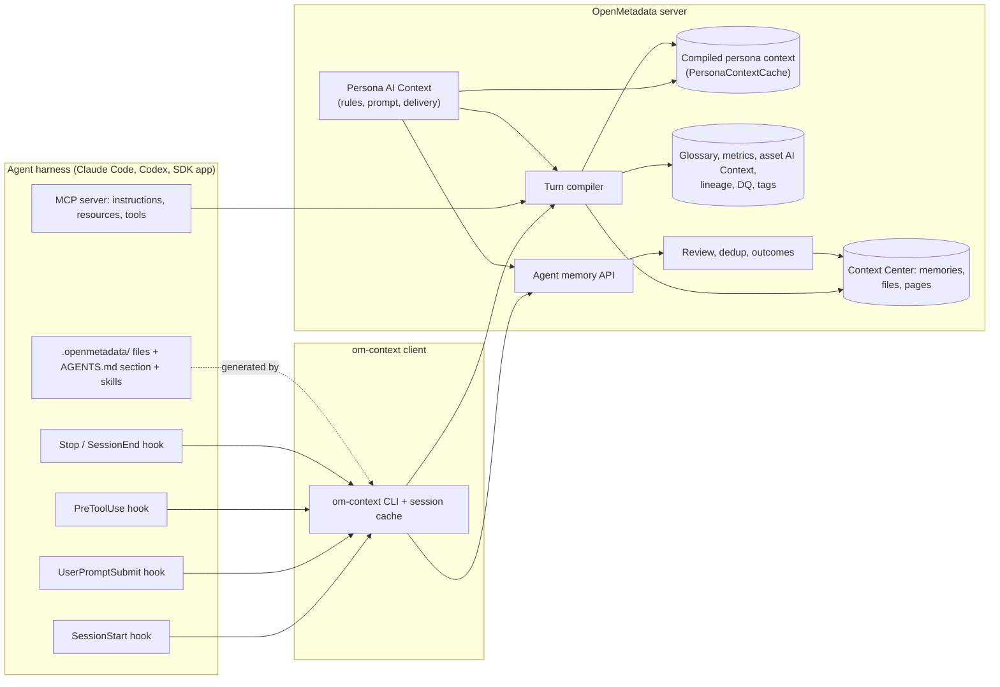

# Persona context harness for every agent surface

- **Status:** Draft for review (no ADR yet; one is written when the design is accepted)
- **Date:** 2026-11-18
- **Scope:** OpenMetadata server, spec, MCP module, UI, and a new client package that installs
  into Claude Code, Codex, and other harnesses

## 1. Problem

OpenMetadata reaches agents through the MCP server (`openmetadata-mcp`). Every piece of context
there is a tool, and the model decides whether to call it. In practice the agent writes SQL against
`raw.orders` without calling `find_context`, never learns that `fct_revenue` is the certified
table, and forgets what it found when the session ends.

Harnesses have channels the model does not choose: instruction files, hooks that run on session
start, prompt submit and tool use, skills, files on disk, MCP server `instructions`, and
admin-managed configuration. A context platform that uses those channels becomes part of every
turn instead of an optional tool.

## 2. Goals and non-goals

Goals:

1. A **default harness** that ships with OpenMetadata and works with no configuration: install one
   package, sign in, and the agent receives governed context on each turn.
2. **Harnesses that admins build per persona**, on top of the existing Persona AI Context: which
   glossary terms, metrics, assets, and articles are used, delivered at which event, with what
   budget, instructions, skills, guardrails, and memory rules. The persona's context is what
   Claude, Codex, and other agents use by default for its members.
3. **Agent memory**: agents store what they learn in Context Center, under the same review,
   visibility, and deduplication rules as memories that people write.
4. One server contract that serves every surface people use (chat apps such as claude.ai, Claude
   Desktop, and ChatGPT; coding harnesses such as Claude Code and Codex; SDK agents), so an
   enterprise governs agent context in one place. Surface-specific code stays in thin adapters.
5. **One agent-agnostic client** that IT pushes to every employee's machine once, and that wires
   itself into every agent installed there, desktop or CLI, without per-agent installs (§8.6).

Non-goals:

- An LLM proxy or gateway. We do not sit between the agent and its model provider.
- Replacing MCP tools. Tools remain for questions the injected context does not answer.
- A new knowledge store. Context Center, the glossary, metrics, and the asset AI Context are the
  stores; this design compiles and distributes them.

## 3. What exists today

| Capability | Where | Reused as |
|---|---|---|
| **Persona AI Context**: per persona, an admin-written `prompt` (instructions, up to 8,000 chars) and up to 25 ordered rules. Each rule selects an `entityType` with an Explore query filter, chooses `sections` (description, schema, joins, glossary terms, metrics, lineage, profile, data quality, …), and sets `maxAssets`, `fullyRendered`, `alwaysInContext`, or `filteredInSearch` (deliver as a search scope instead of preloading). Global `characterBudget` (default 400,000) and `cacheTtlMinutes` | `type/personaContextDefinition.json`; `/v1/personas/{id}/aiContext`, `/aiContext/rules`, `/aiContext/rules/preview`, `/aiContext/status` | **The harness.** §5 builds on it instead of adding a new entity |
| Compiled persona context: per rule the selected entities as full `aiContext` objects, shared knowledge (glossary terms, metrics, articles) rendered once, the search scope from `filteredInSearch` rules, a manifest of compacted or omitted entities, a fingerprint | `type/personaContext.json`; `PersonaContextBuilder`, `PersonaContextCache` (local + Redis, single-flight), `/v1/personas/{id}/context?format=json` | The material the turn compiler selects from |
| Active persona per request; a user's default persona | `ActivePersonaContext`, `persona.default` | The first two steps of context resolution (§5.3) |
| Persona context over MCP, split into line-bounded parts | `GetPersonaContextTool` | Today's delivery, which the model has to page through |
| Context memories: types `Preference`, `UseCase`, `Note`, `Runbook`, `Faq`, `Learning`; scopes `UserGlobal`, `EntityScoped`; visibility `Private` to `Public`; `Draft`/`Approved`/`Archived` lifecycle; supersede and dispute links | `entity/context/contextMemory.json`, `ContextMemoryResource` (`/v1/contextCenter/memories`) | The memory store for agents |
| Machine representation for prompt packing | `contextMemory.machineRepresentation` | Compact text the compiler packs |
| Usage and outcome counters (`appliedCount`, `positiveCount`, `negativeCount`, `correctedCount`) | `PUT /memories/{id}/outcomes`, `MemoryOutcomeWriter` | Ranking signal and the feedback loop |
| Semantic deduplication, reconciliation, conflict review | `SemanticMemoryDuplicateFinder`, `ContextMemoryReconciler`, `context/review/*` | Gate for agent-written memories |
| Review rules: a non-admin's memory starts unapproved and only a review approves it | ADR:2026-10-09-data-consumers-create-context-memories | Agent captures follow the same rule |
| File and page extraction into memories ("knowledge pills") | `FileContextProcessingEngine`, `PageContextProcessingEngine` | Company context source |
| Asset AI Context (identity, knowledge, lineage, type-specific structure, with a context budget) | `type/aiContext.json`, `GetEntityTool` | Asset source |
| Concept routing: question → glossary terms, metrics, articles → candidate assets; bounded concept resolution | `AIContextFinder` (`FindContextTool`), `ConceptContextBuilder` | Prompt-time retrieval |
| User and company context | `GetUserContextTool`, `CompanyContextTool` | Session-start sources |
| Budget tracking, prompt-safe text, token counting | `aicontext/BudgetTracker`, `aicontext/PromptText`, `context/entity/TokenCounter` | Packing in the turn compiler |
| T0 user-preference block with `tokenBudget` (500) and `maxItems` | `aiPlatformConfiguration.contextMemoryConfiguration` | Default for the preference section |
| MCP OAuth and SSO consent | ADR:2026-10-19-mcp-oauth-discovery-stays-inside-the-base-path, ADR:2026-10-23-mcp-sso-asks-consent-after-the-idp-round-trip | Sign-in for the client package |
| Credential masking in MCP responses | ADR:2026-10-20-mcp-responses-mask-stored-credentials | Applies to compiled bundles too |

Most of what a harness needs exists. Persona AI Context already lets an admin decide, per persona,
which glossary terms, metrics, assets, and articles an agent gets, with which sections, and with
what instructions, and it compiles and caches the result. What is missing is **delivery**:

- The compiled document is built for a chat assistant that holds the whole document (up to 400,000
  characters). A hook has a budget of 1,000 to 2,000 tokens per turn. Nothing selects the part of
  the document that matters to one prompt or one SQL statement.
- Outside the Collate chat path, the model receives it only if it calls `get_persona_context` and
  pages through it.
- The persona definition has no notion of events, guardrails, memory capture, or skills.
- There is no agent-facing write path with agent provenance, no client package, and no admin
  preview of what an agent would receive on a turn.

## 4. Architecture



Five parts:

1. **Persona AI Context as the harness** (§5): the existing per-persona rules and prompt, extended
   with delivery settings, guardrails, memory capture rules, and skills.
2. **Turn compiler** (§6): `POST /v1/context/compile`, which selects from the cached compiled
   persona context (plus memories and concept routing) and returns a ranked bundle within a token
   budget for one event. It does not build a second document.
3. **Agent memory API** (§7): capture, feedback, and a file-style interface for SDK agents.
4. **Distribution** (§8): `om-context`, one signed binary that wires itself into every agent
   installed on a machine (§8.1, §8.5); persona-driven MCP `instructions` and resources; and the
   enterprise rollout that makes it the default for every employee (§8.6).
5. **Admin and Context Center UI** (§9): the persona context editor extended with delivery,
   guardrails, and memory settings, the organization default context, a turn preview, and agent
   captures and outcomes in Context Center.

## 5. Harnesses: what to inject, when, and for whom

### 5.1 Which sources to use: glossary, metrics, or assets?

All of them, but **each at the event where it is cheap and precise**. The deciding facts:

- **Glossary terms and metrics** are small, certified, and resolve the vocabulary of a request
  ("ARR", "active customer"). They are the best signal per token, and they lead to assets: a term
  links to the tables that carry it, and a metric to its expression and source. **Default: on, at
  prompt time.**
- **Assets** are many and large. Injecting assets without a concrete target wastes the budget.
  Inject an asset's AI Context only when (a) the request routes to it through a term or metric,
  (b) the prompt or an open file names it, or (c) the repository is bound to it (§8.3). **Default:
  on, routed and bounded (top 3, summary projection).**
- **Lineage, data quality, and tags** matter when the agent is about to read or change a specific
  table. **Default: at PreToolUse on SQL and dbt commands, for the tables touched.**
- **Context Center memories** carry what the catalog does not: preferences, runbooks, learned
  fixes. **Default: preferences at session start, entity-scoped memories with the asset or term
  they attach to, `Learning`/`Runbook`/`Faq` by semantic match at prompt time.**
- **The persona prompt and company context** set the frame. **Default: at session start.**

In Persona AI Context terms, glossary terms, metrics, assets, and articles are **rules** an admin
already writes (`entityType` plus a query filter and sections). The question an admin answers per
rule is no longer only "include it or not" but "deliver it when": every session, matched to the
prompt, before a tool runs, or only as a search scope.

### 5.2 Source × event matrix (default delivery)

| Source | SessionStart | UserPromptSubmit | PreToolUse (SQL/dbt) | Budget share |
|---|---|---|---|---|
| User identity, teams, domains (`GetUserContextTool`) | ✓ compact | | | 5% |
| Persona `prompt` and `alwaysInContext` rules | ✓ | | | 15% |
| Persona rules (preloaded), selected by relevance to the prompt | | ✓ | ✓ for the touched entities | (in the source shares below) |
| Persona `filteredInSearch` rules | | as the search scope for routing | as the scope check | n/a |
| Company context pills (file/page extractions, `Shared`+) | ✓ top-k | ✓ by match | | 10% |
| Memories: `Preference`, `UserGlobal`, owned by the caller (T0) | ✓ | | | 10% |
| Memories: `Learning`, `Runbook`, `Faq`, `UseCase` | | ✓ by match | ✓ for the touched entities | 15% |
| Memories: `EntityScoped` | | with their entity | with their entity | (in the entity share) |
| Glossary terms | | ✓ (`FindContextTool` routing) | | 15% |
| Metrics (with variants and expression) | | ✓ | | 10% |
| Asset AI Context | repo-bound assets, names only | routed or mentioned, top 3 | ✓ full projection | 20% |
| Lineage (1 hop), DQ status, freshness | | | ✓ | (in the asset share) |
| Tag guardrails (PII, deprecated, tier) | | | ✓ warn or deny | n/a |

Default total budgets: SessionStart 2,000 tokens, UserPromptSubmit 1,500, PreToolUse 800. These are
starting points to tune with the evals in §11.

### 5.3 Persona AI Context is the harness

There is no new harness entity. A persona's AI context is the harness, and persona membership is
its assignment. When the caller has no persona context, the **organization default context**
applies: a context that admins define once, with the same shape as a persona's context.

Resolution, evaluated per request, first match wins:

```text
if   active persona (ActivePersonaContext) has an enabled context  -> that persona's context
elif user's default persona has an enabled context                 -> that persona's context
elif admin-defined organization default context is enabled         -> organization default
else                                                               -> built-in default (shipped, read-only)
```

"Has an enabled context" means `contextDefinition.enabled` is true and the context has a prompt or
at least one enabled rule. A persona whose context is empty or disabled falls through, so turning a
persona's context off never leaves its members without context.

The organization default is stored in `contextHarnessConfiguration.defaultContext` and uses the same
`personaContextDefinition` schema, so it has one editor, one compiler, and one cache path
(`PersonaContextCache` under a fixed key such as `org-default`). Until an admin edits it, it equals
the built-in default: the §5.2 delivery and a starter rule set (certified glossary terms and metrics
as search scope, Tier 1 tables as search scope, a short prompt that says what OpenMetadata is and
when to call `get_context`). "Restore built-in default" resets it.

Settings that are not about content inherit, so admins set them once:

| Field | When the resolved context is a persona's |
|---|---|
| `prompt`, `rules` | The persona's own. Content is never merged with the default |
| `delivery` | Each budget the persona leaves unset comes from the organization default |
| `guardrails` | Union of the organization default's and the persona's; the stricter action wins per tag or status. A persona cannot weaken an organization guardrail |
| `memoryCapture` | Fields the persona leaves unset come from the organization default; `requireReview` can only be made stricter |

Every bundle names what was resolved (`"context": {"source": "persona" | "orgDefault" | "builtIn",
...}`), so a user or admin can see why an agent received what it did.

| Harness concern | Persona AI Context today | Added by this design |
|---|---|---|
| Instructions | `prompt` | Rendered as MCP `instructions`, the AGENTS.md section, and the head of the SessionStart bundle |
| What to include | Ordered `rules` (`entityType`, `queryFilter`, `sections`, `maxAssets`, `fullyRendered`) | Nothing |
| Always present | `alwaysInContext` | Mapped to SessionStart |
| Search scope instead of preload | `filteredInSearch` → `searchScope` | Applied to concept routing and prompt-time search |
| When to deliver | No | Per rule `deliverAt: [sessionStart, promptSubmit, preToolUse]`. Absent means the defaults: `alwaysInContext` → `sessionStart`; other preloaded rules → `promptSubmit` and `preToolUse` |
| Budgets | `characterBudget` for the whole document | `delivery` object with a token budget per event (§5.2 defaults) |
| Guardrails | No | `guardrails`: tag, tier, or status → `warn` / `deny` / `none` at PreToolUse |
| Memory capture | No | `memoryCapture`: allowed types, default visibility and share target (e.g. the persona's team), review requirement, per-session cap |
| Skills | Articles (`page`) can be selected by a rule | Per rule `exportAsSkill`: matched pages are published as `SKILL.md` files and org skills |
| Default for everyone | No (a persona marked `default` only assigns a persona) | The organization default context and the built-in default (above) |

Additions to `personaContextDefinition.json` (abbreviated):

```yaml
prompt: "You support finance analysts. Revenue questions use the certified ARR metric…"
rules:
  - { name: Finance metrics, entityType: metric, queryFilter: "<domain = Finance>",
      sections: [definition, formulaExpression, unitGrain, owner], deliverAt: [promptSubmit] }
  - { name: Revenue tables, entityType: table, queryFilter: "<tier = Tier1 AND domain = Finance>",
      sections: [description, schema, joins, glossaryTerms], deliverAt: [promptSubmit, preToolUse] }
  - { name: Finance glossary, entityType: glossaryTerm, filteredInSearch: true }
  - { name: Finance runbooks, entityType: page, queryFilter: "<tag = Runbook>",
      alwaysInContext: false, exportAsSkill: true }
delivery:                                   # new
  sessionStart:  { tokenBudget: 2000 }
  promptSubmit:  { tokenBudget: 1500, minScore: 0.55 }
  preToolUse:    { tokenBudget: 800, matchers: [sql, dbt] }
  memories:      { preferences: 10, learned: [Learning, Runbook, Faq, UseCase] }
guardrails:                                 # new
  - { tag: PII.Sensitive, action: deny }
  - { status: Deprecated, action: warn }
memoryCapture:                              # new
  enabled: true
  allowedTypes: [Learning, Preference, Faq]
  defaultVisibility: Shared
  shareWith: { team: Finance, role: Viewer }
  requireReview: true                       # agent captures start unapproved (§7.2)
  maxPerSession: 5
```

Rules:

- A fresh install works with no admin action: everyone resolves to the built-in default until an
  admin defines the organization default or a persona context.
- Guardrails never widen access. RBAC decides what a caller may see; a persona only narrows it.
- Editing a persona's context stays admin-only, as today.
- A global setting, `contextHarnessConfiguration`, holds the kill switch, hard limits (maximum
  token budget per event, maximum captures per user per day), and `defaultContext`. It is stored through the
  settings-source mechanism in `docs/settings-config-source-design.md`.
- `contextMemoryConfiguration.tokenBudget` and `maxItems` (the T0 block) become the defaults of
  `delivery.memories.preferences`, so the Collate chat path and external agents share one setting.

### 5.4 How a persona change reaches Claude and Codex without reinstalling

The client never bundles persona content. It asks the server:

- `GET /v1/context/session` returns the caller's resolved persona (id, name, entity version,
  context `fingerprint`), the rendered instructions, and the skill list, with an ETag. The plugin
  calls it at SessionStart and caches it on disk. An admin's rule or prompt change takes effect at
  the next session.
- The plugin's hooks are fixed and generic (they call `compile` and `capture`). Everything an admin
  changes lives in the persona, so the plugin is installed once, through managed configuration
  (§8.5), and is never edited per team.
- On chat surfaces, the MCP server builds `instructions` and the `get_context` tool description
  from the caller's persona at connection time. Org skills are regenerated when an
  `exportAsSkill` rule's matches change, and the admin page shows which skills need re-uploading
  where a vendor has no API for it.

## 6. Context compiler

### 6.1 API

`POST /v1/context/compile`

```json
{
  "event": "promptSubmit",
  "session": { "id": "c0ffee…", "harness": "claude-code", "harnessVersion": "2.3.1", "model": "claude-opus-5-5" },
  "workspace": { "repo": "git@github.com:acme/analytics.git", "binding": "acme-analytics", "cwd": "models/finance" },
  "prompt": "add a weekly ARR breakdown by region",
  "toolInput": null,
  "tokenBudget": 1500,
  "format": "markdown"
}
```

Response:

```json
{
  "bundleId": "…",
  "tokens": 1312,
  "context": { "source": "persona", "persona": "FinanceAnalyst", "version": 7, "fingerprint": "…" },
  "text": "<openmetadata-context>…</openmetadata-context>",
  "sections": [
    { "kind": "metric", "fqn": "finance.arr", "score": 0.91, "tokens": 140, "href": "…" },
    { "kind": "glossaryTerm", "fqn": "Business.ARR", "score": 0.88, "tokens": 90 },
    { "kind": "asset", "fqn": "snowflake.prod.finance.fct_revenue", "score": 0.84, "tokens": 420 },
    { "kind": "memory", "id": "…", "memoryType": "Learning", "status": "Approved", "tokens": 75 }
  ],
  "guardrails": [],
  "omitted": [{ "kind": "asset", "fqn": "…", "reason": "budget" }]
}
```

`text` is ready to inject. `sections` gives provenance so the client can report outcomes per item
(§7.3) and the admin preview can explain the bundle. For `preToolUse`, `guardrails` may contain a
`deny` decision that the hook turns into a block.

### 6.2 Pipeline

1. **Resolve the caller and the context**: user, teams, and domains from the token; then the
   context by the §5.3 chain (active persona, default persona, organization default, built-in).
2. **Load the compiled context** from `PersonaContextCache`. The request path never
   compiles: on a miss or a `STALE` entry it uses the last snapshot (or none) and asks the cache's
   single-flight coordinator to refresh in the background.
3. **Collect candidates** per rule and source for the event:
   - SessionStart: the persona `prompt`, entities of rules delivered at `sessionStart`
     (`alwaysInContext` by default), and a one-line-per-rule manifest of what else is available;
   - promptSubmit and preToolUse: entities from the compiled rules whose `deliverAt` includes the
     event, ranked against the prompt or tool input. They are already rendered as `aiContext`
     objects with the rule's `sections`, so no entity is fetched again;
   - shared knowledge (glossary terms, metrics, articles) referenced by the selected entities, from
     `sharedKnowledge`;
   - concept routing through `AIContextFinder` and `ConceptContextBuilder`, restricted to the
     persona `searchScope` when its `filteredInSearch` rules define one;
   - for entities a request names that the persona did not preload: FQNs and table names parsed from the prompt or `toolInput` (SQL parsed with the
     ingestion SQL lineage parser's table extraction, run server-side via the existing query
     parsing used for lineage; if unavailable, a name match against the repo binding's assets);
   - memories by semantic match (the same index `SemanticMemoryDuplicateFinder` reads), plus
     entity-scoped memories of every selected entity.
4. **Authorize**: drop anything the caller cannot view, using `PersonaContextVisibility`,
   `ContextMemorySearchVisibility`, and the asset search filters. Mask credentials.
5. **Rank**: score = relevance × source weight × certification boost × outcome factor. The outcome
   factor comes from `memoryOutcomes` (positive and corrected raise it, negative lowers it).
6. **Pack**: fill by score within each source's budget share, then spend leftover budget in score
   order with `BudgetTracker`. For memories prefer `machineRepresentation.content` when `Ready`;
   for entities use the rule's rendered sections, compacted when they exceed the share. Count with
   `TokenCounter`.
7. **Deduplicate across the session**: the server keeps a bounded per-session set of bundle item
   ids already sent (Caffeine, `maximumSize` 10,000 sessions, expire after 12 h idle), and a repeat
   item is sent as a one-line reference instead of its body.
8. **Render** into delimited text. The persona `prompt` goes in the instructions part; everything else is reference data. Memory and article bodies are user-written, so they are wrapped
   as quoted data with their source, never as instructions (§10).

### 6.3 Latency and failure

- Target p95 under 300 ms for `promptSubmit` and `preToolUse`; SessionStart may take up to 1.5 s.
- The client times out at a configured limit (default 800 ms) and **fails open**: the turn proceeds
  without context, and the client logs it. A hook must never block an agent because OpenMetadata is
  slow or down.
- The compile endpoint reads search and the entity cache only; no LLM call is on the request path.
  LLM work (machine representations, extraction) stays asynchronous, as it is today.

## 7. Agent memory: how agents store what they learn

### 7.1 Where agent memories live

Agent memories are ordinary `contextMemory` entities. No new store. Changes to the schema:

- New `sourceType` value `AgentCapture`.
- New optional object `sourceAgent`: `{ harness, harnessVersion, model, sessionId, workspaceBinding }`.
  It records which agent wrote the memory, the way `sourceConversation` records chat provenance.
- New optional `memoryScope` value `Workspace`: a memory that applies to one repository binding
  (for example "this dbt project builds incremental models with `unique_key`"). It is ranked into
  bundles only for that binding.

### 7.2 Write paths

| Path | Who calls it | Behaviour |
|---|---|---|
| `POST /v1/context/memories/capture` | Stop/SessionEnd hook, or an explicit "remember this" | Accepts up to `maxPerSession` candidates `{type, title, question, answer, entities[], scope, evidence}`. Runs deduplication: a near-duplicate of an existing memory becomes a usage hit or a proposed revision on that memory, not a new one. New memories start unapproved under the existing non-admin rule; the owner sees them as private drafts immediately. |
| MCP tool `remember` | The model, mid-session | Same endpoint. Added so harnesses without hooks can still write. |
| `/v1/context/memoryfs/*` | SDK agents that use a file-based memory tool (for example Anthropic's client-side memory tool) | Maps `view`, `create`, `str_replace`, `insert`, `delete`, `rename` on `/memories/<path>` to memories. The path maps to scope and folder: `/memories/me/…` → `UserGlobal`, `/memories/entity/<fqn>/…` → `EntityScoped`, `/memories/workspace/<binding>/…` → `Workspace`. Writes go through the capture rules above. |

Capture itself is in the client: at Stop, the hook sends the turn's tool failures and their fixes,
plus explicit user corrections, to `capture`. The server decides what to keep. That keeps
extraction logic in one place (the existing `ContextMemoryExtractor` and reconciler) instead of in
each client.

Review: captures go to Context Center's existing review flow. An admin can set
`memoryCapture.requireReview: false` for `Private` memories only; anything shared beyond the author
always needs review, matching ADR:2026-10-09-data-consumers-create-context-memories.

### 7.3 Feedback

`POST /v1/context/feedback` with `{bundleId, items: [{id, signal}]}`, where `signal` is `applied`,
`helpful`, `unhelpful`, or `corrected`. The client sends `applied` for each item the agent saw.
Explicit signals come from a user correction or an agent report. The server aggregates events and
writes counters through the existing recount path (`MemoryOutcomeWriter`), which stays admin- and
bot-only. Clients never write counters directly.

### 7.4 Making OpenMetadata the agent's memory on each surface

Agents have their own memory features. The aim is that what an agent learns about data ends up in
OpenMetadata, where it is governed, shared after review, and available to every other surface.

| Surface | Native memory | How writes reach OpenMetadata | How reads come back |
|---|---|---|---|
| Claude Code | Local memory files (CLAUDE.md, auto-memory directory) | Stop hook → `capture` (§7.2). Optionally, a PostToolUse hook on writes to the memory directory mirrors new data-related entries to `capture`. | SessionStart bundle (preferences, workspace memories) |
| Codex | AGENTS.md and its own memory settings | Stop hook → `capture`; `remember` tool | SessionStart bundle; the AGENTS.md section from `om-context sync` |
| claude.ai, Claude Desktop, ChatGPT | The vendor's chat memory, which we cannot redirect | `remember` tool. The persona instructions and org skill tell the model to use `remember` for facts about data, metrics, and definitions. | `get_context` returns preferences and matched memories |
| SDK agents | Whatever the developer wires | `memoryfs` as the backend of a file-style memory tool, or `capture` | `compile`, or `memoryfs` reads |

The vendor's chat memory stays the user's personal memory; OpenMetadata does not try to replace
it. The persona's `memoryCapture` rules narrow what goes to OpenMetadata to organizational knowledge: corrections to
definitions, query fixes, table conventions, runbooks. That is the knowledge other people's agents
benefit from, and the knowledge that needs review before it is shared.

## 8. Distribution: how harnesses use it

### 8.0 Surfaces: one interface, three kinds of client

Enterprise users reach agents through chat apps (claude.ai, Claude Desktop, ChatGPT), through
coding harnesses (Claude Code, Codex CLI and IDE, Cursor), and through agents built on the SDKs.
Enterprises want one governed interface across all of them. The server contract is the same for
every surface: the persona's context (§5), the compiler (§6), and the memory API (§7). Only the transport
differs, and each surface gets the most deterministic channel it offers.

| Surface | Channels the host controls | How OpenMetadata reaches it | How memories are written |
|---|---|---|---|
| Chat apps (claude.ai, Claude Desktop, ChatGPT; Codex cloud tasks) | Org-provisioned remote MCP connectors, MCP server `instructions`, MCP resources and prompts, org-provisioned skills, project instructions | The **remote MCP server** that admins enable as an org connector. Its `instructions` and an org skill tell the model to call `get_context` first; `get_context` is the compiler exposed as one tool. Resources (`om://context/session`, `om://entity/<fqn>`) can be attached by the user. | `remember` tool, prompted by the skill and the server instructions |
| Coding harnesses (Claude Code, Codex CLI and IDE, Cursor, Gemini CLI) | Managed settings, hooks, AGENTS.md, skills, files on disk, MCP | `om-context` (§8.1), which installs hooks that call the compiler on every turn, with no model decision; files and AGENTS.md (§8.2) for harnesses without hooks; the same remote MCP server for drill-down | Stop hook → `capture`, plus `remember` |
| SDK agents (Claude Agent SDK, Messages API, OpenAI Agents SDK, internal agents) | The system prompt and tool loop the developer owns | `POST /v1/context/compile` called by the app before each model call | `capture`, `feedback`, and `memoryfs` as the backend of a file-style memory tool |

Chat apps have no hooks, so delivery there is tool-mediated, and that is the weakest link. Three
measures narrow the gap:

1. **One context entry point.** `get_context(question, entities?)` returns a compiled bundle, so
   the model makes one decision instead of choosing among about 20 tools. The existing tools stay
   for drill-down.
2. **Server `instructions` generated from the caller's persona context** (§8.4): hosts put them in the system prompt,
   so the first instruction the model sees tells it to call `get_context` on any data question.
3. **An org-provisioned skill** that admins upload once (generated by OpenMetadata, §8.5). It
   carries the persona frame and the "call `get_context` first, `remember` corrections" procedure.
   It loads on matching tasks, independently of tool choice.

The remote MCP server is the transport common to every surface: chat apps, coding harnesses, and
SDK agents all support remote MCP. The plugin and files add determinism where the surface allows it,
and do not replace the MCP server.

### 8.1 The `om-context` client

One signed binary per OS and architecture, `om-context`, written in Go so it needs no Python, Node,
or JVM on the machine. It contains no persona content and no per-agent code paths beyond small
adapters; everything an admin changes comes from the server (§5.4). Subcommands:

| Command | Purpose |
|---|---|
| `om-context login` | Browser OAuth through the server's existing MCP OAuth and SSO flow (device-code flow on headless machines), or a personal access token. Tokens go in the OS keychain (macOS Keychain, Windows Credential Manager, libsecret), never in config files or repos |
| `om-context install [--agents all\|<list>] [--system]` | Detects installed agents and writes each one's configuration (§8.6). `--system` writes the machine-wide, managed locations that users cannot override |
| `om-context hook <event> --agent <name>` | Entry point every agent's hooks call. Reads the agent's hook JSON on stdin, calls `compile` or `capture`, and writes the agent's expected output (additional context, or a block decision). Fails open on timeout |
| `om-context mcp` | A local stdio MCP server that proxies to the remote `/mcp` endpoint with the keychain token, for agents that only launch local (stdio) MCP servers |
| `om-context sync` | Writes the `.openmetadata/` files, the AGENTS.md section, and the persona's skills (§8.2) |
| `om-context doctor` | Shows, per detected agent, what is installed, which channels are active, the signed-in user, the resolved persona, and the server version |
| `om-context uninstall` | Removes exactly what `install` wrote (it records a manifest of its edits) |

**Agent adapters are data, not code.** An adapter is a small manifest: where the agent keeps its
user and managed configuration on each OS, its config format, its hook event names and I/O shape,
how it loads skills and MCP servers, and its instruction-file name. The binary embeds the manifests
it was built with and fetches newer ones from the server (`GET /v1/context/agents`), signed. Support
for a new agent, or a vendor's changed config path, therefore ships with an OpenMetadata server
upgrade or a manifest update, not with a new binary on every laptop.

### 8.1a Distribution channels for the binary

| Channel | Audience | Notes |
|---|---|---|
| **The OpenMetadata server itself**: `GET /downloads/om-context/<os>-<arch>` and an install script at `/downloads/om-context/install.sh` and `install.ps1` | Every deployment, including air-gapped ones | The binary version matches the server, and the script pre-fills the server URL. This is the default path shown in the UI |
| macOS `.pkg` and Windows `.msi` with a post-install `om-context install --system` | IT, through MDM (Jamf, Intune, Kandji, Workspace ONE) | Notarized and signed (Apple Developer ID, Authenticode). The package takes the server URL and agent list as MDM-provided config |
| Homebrew tap, winget, Scoop, `.deb`/`.rpm` repos | Individual developers and Linux fleets | Same signed artifacts |
| `npx @openmetadata/context` and `uvx openmetadata-context` shims | Agents that start MCP servers through npx or uvx, and developers who expect that | The shims download and verify the matching binary; they contain no logic |
| Container image and a devcontainer feature; a GitHub Action `setup-om-context` | Dev containers, CI, and cloud coding agents (Codex cloud, Claude Code on the web) | Uses a bot or workload token from the secret store |
| `.mcpb` desktop extension bundle | Claude Desktop users who cannot use an org connector | Wraps `om-context mcp` |

Every artifact is signed, published with checksums, an SBOM, and a provenance attestation.
`om-context` checks the server's advertised version at login; in managed mode, updates come from
the MDM channel only and self-update is off.

### 8.2 Files for harnesses without hooks

`om-context sync` writes:

- `.openmetadata/context/` (gitignored): one Markdown file per repo-bound asset, glossary term, and
  metric, plus `index.md`. Any agent can grep it.
- A delimited section in `AGENTS.md` (between `<!-- openmetadata:begin -->` and
  `<!-- openmetadata:end -->`) with the repo's data domains, certified tables, and a pointer to
  `.openmetadata/context/`. AGENTS.md is read by Codex, Cursor, Copilot, Gemini CLI, and, through a
  `CLAUDE.md` link, Claude Code.

### 8.3 Repository bindings

The compiler needs to know which assets a repository touches. In order of precedence:

1. `.openmetadata/binding.yaml` committed in the repo: `{ binding: acme-analytics, services: [...], domains: [...] }`.
2. Detection: a dbt `manifest.json` maps models to OpenMetadata tables through the existing dbt
   ingestion FQN rules; otherwise SQL files are scanned for table names.
3. A server-side `workspaceBinding` record (admin-managed) that lists repo URLs per binding, so a
   binding works without a committed file.

### 8.4 MCP changes

- Server `instructions` are generated from the caller's persona context: what OpenMetadata is, the persona frame, and
  when to call which tool. Hosts place them in the system prompt, so harnesses that only install the
  MCP server still get a session-start frame.
- MCP resources: `om://context/session` (the SessionStart bundle) and `om://entity/<fqn>` (an
  asset's AI Context), so a user can @-mention them.
- MCP prompts: `/om-context <question>` returns a compiled bundle on demand.
- The `get_context` tool: the compiler with `event: promptSubmit`, for surfaces without hooks
  (§8.0). Its description says to call it first on any question about data, metrics, or
  definitions.
- The `remember` tool (§7.2).

### 8.5 Agent coverage

What `om-context install` wires for each kind of agent. The specific paths and admin controls
come from the adapter manifests and must be checked against each vendor's current documentation
before each release; they change often.

| Agent | MCP | Hooks (deterministic) | Instructions and skills | Managed (enterprise) location |
|---|---|---|---|---|
| Claude Code (CLI, IDE, desktop) | Remote `/mcp` | SessionStart, UserPromptSubmit, PreToolUse, Stop | Plugin skills, CLAUDE.md link to AGENTS.md | `managed-settings.json` |
| Codex (CLI, IDE, desktop app) | Remote `/mcp` | `hooks.json` events | `.agents/skills`, AGENTS.md | `requirements.toml`, cloud-managed config, MDM preference domain |
| Cursor, Windsurf, VS Code with Copilot, Gemini CLI, JetBrains AI | Remote `/mcp` or `om-context mcp` | Where the agent supports hooks | Rules files and AGENTS.md | The vendor's team or enterprise settings, where offered |
| claude.ai, Claude Desktop chat, ChatGPT | Org connector to remote `/mcp` | None | Org skills, MCP `instructions` | The vendor's admin console |
| Agents with only an MCP config file | `om-context mcp` | None | AGENTS.md if they read it | None |

The binary is agent-agnostic because the contract it implements is: (1) MCP, which every agent
supports; (2) one hook command whose adapter translates input and output; (3) plain files that any
agent can read. An agent that supports only (1) still gets the persona instructions and
`get_context`; each additional channel makes delivery more deterministic.

### 8.6 Rolling it out as the default for every employee

The aim: on day one, an employee opens any agent and it already has their persona's context and
writes memories to OpenMetadata, with no action from them beyond SSO.

1. **Prepare the server.** Turn on MCP with SSO-backed OAuth (no per-user tokens to distribute).
   Define the organization default context (or accept the built-in one); it covers every employee
   without a persona context. Add persona contexts for the groups that need their own; organization
   guardrails and memory rules apply to them too.
2. **Web and desktop chat apps.** In the Claude Team/Enterprise and ChatGPT Business/Enterprise
   admin consoles, add the OpenMetadata remote MCP connector for the organization and upload the
   generated org skill. Users authorize once through SSO.
3. **Managed machines.** Push the signed `.pkg` or `.msi` through MDM with the server URL. Its
   post-install step runs `om-context install --system --agents all`, which writes the managed,
   user-unmodifiable configuration of every detected agent: plugin, hooks, MCP server, skills.
   Where an agent's managed settings can restrict MCP servers to an allowlist, the admin can also
   make OpenMetadata the approved data-context server. Agents installed later are picked up by a
   scheduled `om-context install --system` that MDM runs daily.
4. **First use.** The first hook or MCP call with no token opens the SSO login once, in the browser.
   The token lands in the keychain. No secret ever goes through MDM.
5. **Repos, containers, and cloud agents.** Commit `.openmetadata/binding.yaml` and the agents'
   project settings (which reference the plugin) to data repositories. Dev containers use the
   devcontainer feature; CI and cloud coding agents use the GitHub Action or container image with a
   bot token.
6. **Verify coverage.** The Agents page (§9) lists who connected from which agent and client
   version, and the share of employees with at least one connected agent in the last 7 days.

The admin UI's Distribution page generates every artifact this needs: the MDM package parameters,
the connector URL and OAuth settings, the org skill, and per-agent snippets for agents that are not
on managed machines.

## 9. Admin and Context Center UI

**Context Center → AI Context** (the existing persona context pages, extended; ui-core components):

- The rule editor gains a **Deliver at** choice per rule (every session, matched to the prompt,
  before a tool runs, search scope only) and an **Export as skill** toggle for page rules.
- New tabs on a persona's context: **Delivery** (token budget per event, §5.2 defaults),
  **Guardrails**, and **Memory** (capture rules).
- **Turn preview**: pick a user and an event (the preview shows which context the user resolves
  to and why), type a prompt (and optional SQL),
  and see the bundle an agent would receive, with the score, token count, and the reason for each
  section and omission. It sits next to the existing rule preview, which shows what a rule
  matches; the turn preview shows what an agent actually gets.
- **Organization default context**: the same editor (rules, prompt, delivery, guardrails, memory)
  for `defaultContext`, with "Restore built-in default", and a list of which personas override it.
- **Settings → AI → Agent distribution**: the artifacts of §8.6 and the download links of §8.1a.

**Context Center** additions:

- An **Agents** tab: connected agents and client versions (from `sourceAgent` and compile telemetry), captures
  waiting for review, and the most-applied and most-corrected memories.
- The memory list filters by `sourceType = AgentCapture` and by agent, and shows outcome counts on
  each memory.
- Workspace-scoped memories appear under their binding.

How Context Center content is used, end to end:

| Context Center content | Read by agents | Written by agents |
|---|---|---|
| Preferences (`UserGlobal`, private) | SessionStart, T0 block | Capture when the user states a preference |
| Entity-scoped memories | With their entity at prompt time and PreToolUse | Capture tied to the tables an agent fixed a query against |
| Learnings, runbooks, FAQs | Prompt-time semantic match | Capture of failure → fix sequences |
| Company context (file and page pills) | SessionStart top-k and prompt match | No (people upload files) |
| Persona AI Context (prompt and rules) | Prompt at SessionStart; rule entities per their delivery setting | No (admin-authored) |
| Workspace memories (new) | Only for their repo binding | Capture of repo conventions |

## 10. Security

- **Authentication**: OAuth or PAT per user. A bundle is compiled as the calling user, so it never
  contains anything the user cannot view in the UI.
- **Prompt injection through stored text**: memory bodies, article text, and descriptions are
  written by users and by agents. The compiler wraps them in delimited, quoted blocks with their
  source, and by default injects only `Approved` memories plus the caller's own drafts. A draft
  captured by one user's agent never reaches another user before review.
- **Credential masking**: compile output passes through the same masking as MCP responses.
- **Data minimization**: bundles contain metadata, not table data. Sample data and profiler values
  are excluded unless a persona rule enables them (the `profile` section), and they follow the existing sample-data permission.
- **Audit**: each compile and capture records user, agent, persona id and version, and item ids (not
  prompt text by default; prompt logging is an opt-in with a retention limit).
- **Hook trust**: the plugin runs only `om-context`, signed, which makes HTTPS calls to the
  configured server. It does not read files outside the workspace except its own config.

## 11. Measuring whether it helps

- Telemetry per event: latency, tokens, item counts, fail-open rate.
- Outcome rates per source and memory (§7.3).
- An offline eval set: data tasks (write the ARR query, add a DQ test, fix a broken dbt model) run
  with delivery on and off and with alternative persona delivery settings, scored on correctness against the
  certified definition. The default budgets in §5.2 change only on eval evidence.

## 12. Open decisions

1. Client language: Go static binary (no runtime required) or a Node package (reuses the TS SDK).
   Recommendation: Go, with npx and uvx shims.
6. The persona budget is in characters (`characterBudget`, and `tokensEst` = characters / 4 in
   ADR:2026-10-14-persona-ai-context-status-reads-the-cache-and-pages-like-the-persona-list) while
   delivery budgets are in tokens. Recommendation: delivery uses `TokenCounter`; the persona
   document keeps characters.
7. Whether a user with several personas gets only the active one, or a merge. Recommendation: the
   active one, with the persona name in every bundle so the user can see which applied.
2. Whether `Workspace` is a new `memoryScope` value or an `EntityScoped` memory attached to a new
   `workspaceBinding` entity. A new entity costs more, but gives bindings an owner and RBAC.
3. Whether PreToolUse `deny` guardrails ship enabled by default, or as `warn` only until admins
   opt in. Recommendation: `warn` by default.
4. Whether the session dedupe set (§6.2) is per server node, or shared through Redis when it is
   configured.
5. OSS and Collate boundary: the turn compiler, persona extensions, capture, and client in OSS; Collate's chat path
   moves onto the same compiler so the two cannot drift.

## 13. Delivery plan

Each phase ends in a state that can be shipped and tested.

| Phase | Ships | Verified by |
|---|---|---|
| P0 | Context resolution chain (§5.3) with the built-in default and `contextHarnessConfiguration.defaultContext`; persona context `deliverAt` and `delivery` fields; `GET /v1/context/session`; the `contextHarnessConfiguration` setting; `POST /v1/context/compile` for `sessionStart` and `promptSubmit`; the `get_context` MCP tool and persona-generated MCP `instructions` (reaches chat apps first); `om-context` (login, install, hook, mcp, doctor) for Claude Code and Codex, served from the server's downloads endpoint | Compile ITs per source and RBAC case; a connector test from claude.ai and Claude Desktop; a hook test in Claude Code and Codex against a local server |
| P1 | `AgentCapture` source type and `sourceAgent`; persona `memoryCapture`; `capture`, `feedback`, and the `remember` tool; Stop hook; Context Center Agents tab | Capture ITs (dedup, review start state, visibility); outcome recount IT |
| P2 | `preToolUse` with SQL table extraction, lineage, DQ, and persona guardrails; repo bindings and `om-context sync` files and AGENTS.md section | Guardrail ITs (warn, deny, RBAC); binding detection tests on a dbt fixture |
| P3 | Persona context editor additions (deliver at, delivery, guardrails, memory, export as skill) with the turn preview; Agent distribution page; signed `.pkg`/`.msi`, Homebrew, winget, shims; adapter manifests for Cursor, VS Code, Gemini CLI; `memoryfs`; `Workspace` scope | Playwright for the editor and turn preview; install/uninstall tests per adapter on macOS, Windows, Linux; memoryfs contract tests |
| P4 | Eval harness and default-budget tuning; Collate chat on the compiler | Eval report comparing policies |
